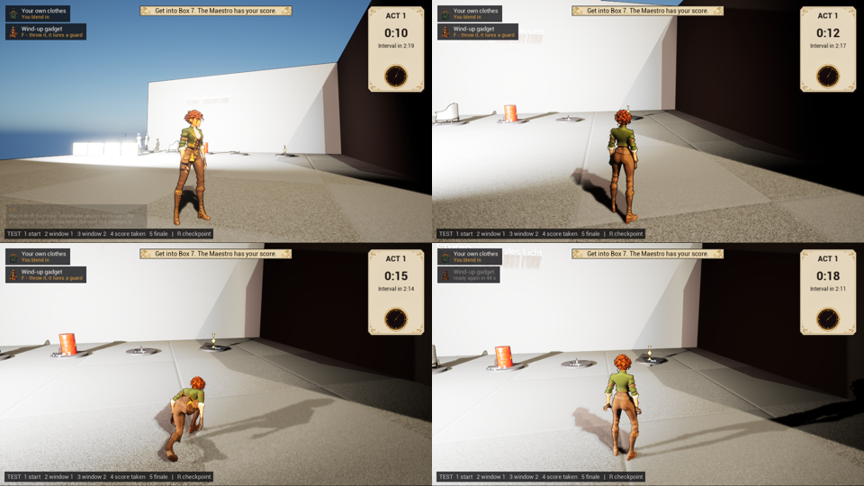

# DEVLOG - Team Produktlicht (2026 Epic AI MegaJam)

The story of HOW we built this - our **Glass Box** entry. Append newest at the bottom, under a dated
sub-heading per person. See `DOCUMENTATION.md` for the full protocol. Capture AI-driven moments with a
screenshot/clip saved in `devlog/media/` and reference it.

**Entry template:**
```
### <YYYY-MM-DD HH:MM> - <Rene | Friend | Music PM> (<which AI/tool>)
- What:     <what we set out to do>
- AI did:   <what the agent did specifically>
- Result:   <works / partial / blocked>; build runs: <yes/no>
- Media:    devlog/media/<file>
- Note:     <any decision + why>
```

---

<!-- entries below, newest at the bottom -->

### 2026-11-10 18:00 - Friend/Mehmet (Claude Code + Unreal MCP)
- What:     Phase-0 setup of the build machine and proof of the UE + MCP pipeline (no game content).
- AI did:   Claude checked the machine, installed the missing VS 2026 workloads, generated the empty C++
            project from Epic's Blank template without the editor dialog, enabled the MCP plugins + server
            auto-start, read the MCP plugin source to get the exact `.mcp.json` format, wrote its own small
            MCP test client, then via MCP spawned a cube + light and started/stopped Play. First Shipping
            package failed on cook (GameFeatureData rule missing, side effect of AllToolsets) - Claude read
            the log, added the AssetManager rule, second build succeeded.
- Result:   works; build runs: yes (empty package 473 MB, zip without .pdb 330 MB)
- Media:    -
- Note:     MetaHuman plugins alone grew the empty package to 1031 MB (limit 1 GB) -> kept off until needed.

### 2026-11-11 19:15 - Friend/Mehmet (Claude Code + Diversion)
- What:     Join the shared Diversion repo and bring the tested VKTJam project into the repo root.
- AI did:   Claude installed/verified the dv CLI, cloned `megajam`, pulled Rene's `.dvignore`, copied only
            .uproject / Source / Config / Content / .mcp.json, set the compiler to Visual Studio 2026 and
            checked `dv status` (no Binaries/Intermediate/Saved/DDC) before any commit. Then compiled at
            the new location, re-ran the MCP spike (cube + light + Play, test actors removed, nothing saved)
            and built a Shipping package from the repo. Packaging left file-open-order logs and per-user
            Content folders -> Claude added them to `.dvignore` so they never get committed.
- Result:   works; build runs: yes (Shipping, 0 errors, zip without .pdb 330 MB)
- Media:    -
- Note:     Team decision (PM): VKTJam = project in repo root; internal name != game name; team = Produktlicht.

### 2026-11-12 10:30 - Friend/Mehmet (Claude Code)
- What:     Prepare the art pipeline folders before the concept is locked: 2D sources for Codex, film/trailer area.
- AI did:   Claude created `artwork/` (concept, style bible, Codex briefs, references, characters, props,
            environment, UI) with a README for the flow Codex -> Tripo/Rodin -> Unreal, an `AGENTS.md` that tells
            Codex where to save and the image-to-3D rules (4 views, A-pose, neutral background), a brief template,
            and `film/` (storyboard, prompts, raw clips, edit, final incl. the 30-60 s gameplay video). It also
            switched the import scripts on the build machine to Rene's folder rules (`/Game/Art/Characters`,
            `/Game/Art/Environment`, 180 cm metrics).
- Result:   works (structure only, no game content yet); build runs: yes (no project change)
- Media:    -
- Note:     Flow: Claude writes the brief, Codex draws, Claude checks.

### 2026-11-12 08:39 - Rene (Zentrale harness: autopilot loop, 9 Claude agents)
- What:     Concept round 2 after the theme reveal - an open run instead of a narrow brief.
- AI did:   A free autopilot loop in an isolated cage got only the producers' own words as its goal, plus two short
            files (jam facts + fences, the team's wishes and verbatim feedback on round 1). It split the work across
            9 agents (authors, reviewers, QA), wrote 4 concepts with 4 different core loops (disguise/staging,
            ghost-take stealth, live-TV camera cutting, light/shadow stealth), a style + image/sound guide and a
            jury/marketing/video guide, reviewed itself in 3 rounds and ranked the concepts. 47 minutes.
- Result:   works; the producers picked concept A "Sotto Voce: The Cut" and changed it (no ghosts -> light steampunk
            stage machinery); build runs: n/a (no game files)
- Media:    -
- Note:     Round 1 (Nov 11, pre-jam, declared) used a narrow brief, and all three drafts got the same mechanic from
            it. Lesson for directing agents: separate hard fences from wishes, keep your own hypotheses out of the
            brief, treat the theme as a loose link - otherwise every agent reads "Director's Cut" as "film".

### 2026-11-12 12:15 - Rene (Claude, Zentrale PM)
- What:     Lock how two producers and their AI crews work in parallel, then lock the MVP.
- AI did:   The PM wrote the binding parallel model (COLLABORATION.md 1.2: map layers with one owner each, C++ base
            class + Blueprint child, metrics, placeholder swap, `sync-vertrag.csv`, merges at 13:00/19:00,
            `BOARD.md`), a rough jam plan after asking the Zentrale CTO (budget, night runs) and the music PM (music
            in 3 days), and cut concept A into the MVP spec `docs/spec/mvp-sotto-voce.md` (2 zones, cellar optional,
            4 verbs, 3 steam cues, 10-min opera clock, 2 endings, 4 music pieces).
- Result:   works; spec accepted by both producers at 12:15; build runs: n/a
- Media:    -
- Note:     Producer model: Claude writes all C++, the art side runs automated; the humans direct, play and accept.

### 2026-11-12 12:55 - Rene (Claude Code, headless Unreal: UBT + Python commandlet)
- What:     M0 foundation of the build plan (`docs/spec/bauplan-technik.md`): a playable third-person character in an
            empty project, the shared map with its owner layers, and a greybox of stage and box - without opening
            the editor once.
- AI did:   Researched the approach first (Engram had nothing on game AI/stealth; sources: "The AI of Hitman (2016)",
            Epic forum on StateTree vs BT). Copied the UE5 template mannequin/input/prototyping packs, wrote the C++
            player (`ASVCharacter`: walk/sneak/run, costume tag, interact search, restart, pause), a controller that
            builds the game's input actions in code (no input assets to create), native gameplay tags, an
            interactable base and the game mode. Compiled with UnrealBuildTool (first try, 114 s). Built `L_Main` +
            4 layers and the greybox with a headless Python commandlet (`Tools/Editor/build_l_main.py`), then ran the
            game headless to check the log: SVGameMode loads, all 4 layers stream in, the character spawns.
- Result:   works; build runs: editor target yes (packaging not tested yet)
- Media:    -
- Note:     Everything that defines behaviour is text (C++, ini, a Python layout script) - diffable and repeatable
            by an agent; the only binary maps are generated.

### 2026-11-12 - Music PM (musikstudio, Claude)
- What: take over ALL music AND sound for Sotto Voce; first decide the sound source, then short style probes (60-90 s)
  so René AND his colleague can steer before hours go the wrong way.
- AI did: the Music PM (Claude) proposed a free sample library; René chose pure synthesis instead: "wir versuchen es
  mit synthes also ohne samples. es ist steam punk daher haben wir auch hier künstlicherische freiheit ... ein
  realistisches szenario wäre zu gefährlich da man dann auf details achtet." Claude then wrote a Python synthesizer
  (`sottovoce_musik.py`) with a stylized steam orchestra (steam whistle, brass, strings, tuba, timpani, organ) AND
  Lucienne's instruments (music box, harmonium, pizzicato, clockwork), composed the theme "The Quill" AND made
  Valcourt's opera out of HER theme in disguise (same contour, other key AND rhythm) - the story's theft, audible.
- Iterations: probe 1 - title accepted ("titel klingt vom stil gut"), opera act 1 rejected: "klingt ... bisschen wie
  jahrmarkt, der start ist gut aber es wirkt schnell zu fröhlich, eher etwas düsterer. steam punk, story man wurde
  bestohlen und holt seine rechte zurück". Probe 2 - act 1 rebuilt in D minor at 72 BPM, organ AND low string pulse,
  the stage machine playing in time (gear clank on 1, steam exhale on 3), no waltz, no whistle lead: "klingt gut".
- Result: works; delivery 1 = title + act 1 (stage AND behind-walls version, sample-aligned for a zone crossfade).
  Every seam AND level measured (-14 LUFS, peaks <= -1 dBFS); renders are reproducible bit for bit from the code.
- Media: docs/audio/listen.html (listening page with the stage / walls switch)
- Note/decision: no AI audio models AND no samples - every note IS code, which keeps the rights clean AND the whole
  soundtrack reproducible. Next: act 2 with a synthesized choir AND the escape (probe 3, with René), then interval,
  finale, alarm, stingers, endings, sounds AND ambience.
- Later the same day: probe 3 - opera act 2 with a synthesized choir (G minor, her key: the opera drifts towards her
  original) AND the escape after the theft (her own theme, hunted; same bar grid as the opera, SO the game switches on
  a bar line). Delivered as PREVIEWS for René AND his colleague to judge from the repo: "alles übergeben damit es im
  repo landet und der kollege sich auch anhören kann."

### 2026-11-12 13:30 - Rene (Claude, Zentrale PM)
- What:     Bring music delivery 1 into the repo so both producers can listen.
- AI did:   Verified the delivery's checksums against its manifest, copied it to `docs/audio/`, listed it in
            ASSETS.md, and built a listening page `docs/audio/listen.html` from `sounds.json` (stage / behind-walls
            crossfade, "score taken -> escape" on the next bar line). The Music PM's own page and generator script
            did not pass the Zentrale's data-only delivery filter; he is asking the architect for a docs exception.
- Result:   works; build runs: yes (no project change)
- Media:    docs/audio/listen.html
- Note:     Import into `Content/Audio` follows with the audio integration (the event -> file table is in `sounds.json`).

### 2026-11-12 13:50 - Rene (Claude Code, headless Unreal: UBT + Python commandlet + automation tests)
- What:     M1 "see and be seen" - the core of the game: one stealth loop that can be played and judged.
- AI did:   Wrote the suspicion maths as engine-free C++ (`FSVSuspicionModel`: fill by wrong-zone costume, "sees
            through" up close, running; distance falloff; busy x0.5 / idle x1.5; decay) with 5 automation tests run
            headless (all green; e.g. "wrong costume, point blank, idle NPC = full eye in ~2 s" from the spec). Built
            the NPC brain as a plain C++ state machine (schedule / investigate / suspicious / alarm / return) with a
            custom sight test (cone + range + one line trace at 10 Hz), guards that patrol on the navmesh and go to
            look at stage cues, costume zones, costume racks, the Steam-down valve, a canvas HUD (suspicion eye over
            each NPC with ? and !, costume line "You blend in / You do not belong here", E-prompt) and a fair fail
            screen ("Curtain. Caught by Gaspard - that costume does not belong here"). Placed everything with a
            re-runnable Python script. Debugged a missing navmesh headless: the map had nav data slots but no
            polygons - the game mode now builds the navmesh at start (0.01 s) and logs a check.
- Result:   works headless (guards path without errors, tests green); build runs: editor target yes; not yet
            played with eyes - that is the 19:00 acceptance
- Media:    -
- Note:     Research said: no AIPerception (only "seen/not seen"), no StateTree (graph assets are hard for an agent
            to edit) - the whole NPC logic is ~400 lines of readable C++.

### 2026-11-12 14:05 - Rene (Claude Code: game screenshots as the agent's eyes)
- What:     First play test by Rene: the logic worked (log: zone entered, guard suspicious, smock taken, guard calm
            again), but the screen was black apart from the HUD.
- AI did:   Gave itself eyes: a `-svshot` / `-svshotquit` switch in the game mode takes a screenshot 6 s after start.
            Reproduced the black screen, then rendered the engine's template map for comparison (renders fine ->
            not the laptop's GPU), found the cause - the placeholder lights were not movable while the project
            allows no baked lighting - and replaced them with movable lights plus warm work lamps
            (`Tools/Editor/fix_placeholder_lights.py`). Screenshot after the fix shows wings, racks and the Pompier.
            The DirectX notice on start is the laptop's Iris Xe falling back from DX12/SM6 to DX11/SM5; the desktop
            shortcut now starts with `-dx11`.
- Result:   works; build runs: yes
- Media:    devlog/media/2026-11-12_m1_greybox_first_light.png
- Note:     From now on every milestone is checked with a screenshot before Rene plays it.

### 2026-11-12 14:20 - Rene (Claude Code, headless Unreal + CSV data + automation tests)
- What:     M2 "the opera is the clock": a 10-minute premiere in 4 phases, every NPC on a timetable, checkpoints
            instead of reloading the level.
- AI did:   Moved all balancing into three CSV files (`Data/phases.csv`, `npcs.csv`, `schedule.csv` - 24 schedule
            rows) imported as DataTables by a headless script; wrote an engine-free clock model with 2 more tests
            (7/7 green), an opera-clock world subsystem, NPCs that read their timetable per phase (on stage / off
            stage, busy or idle, patrol points), act bells that fade the screen while NPCs change places, checkpoints
            at every phase start, R = back to the checkpoint in under a second (clock, NPCs, Lucienne, costume), and
            a final curtain at 10:00. Added Brac (sees through stagehands and chorus up close), Valcourt (on rails,
            leaves his box when the trap rises), a chorus singer and a stagehand, plus the Fly and Trap cues. HUD:
            a programme sheet with act, opera time and "next bell in" (the last 30 s pulse) and a banner at each
            bell. Checked by screenshot (interval bell) and a headless run through the final curtain and restart.
- Result:   works; build runs: yes (editor target); not yet played with eyes
- Media:    -
- Note:     Debug switches for testing without waiting: `-svclock=<seconds>` starts the clock later,
            `-svshot` / `-svshotat=<s>` / `-svshotquit` take a screenshot.

### 2026-11-12 14:45 - Rene (Claude Code, headless Unreal + screenshots)
- What:     Rene's play test of M2 ("the figures slide over the floor"), then M3 "the whole evening": take the
            score, two endings, hiding, the gadget - plus test scenes so both producers can jump to any moment.
- AI did:   Found the sliding: AI path following set the velocity directly, so the template anim BP saw no
            acceleration and stayed in idle - switched NPC paths to acceleration (UE 5.5+ moved that flag into
            NavMovementProperties; the first compile told us). Built the score portfolio (only when nobody watches),
            the alert after the theft (x1.5, search routes from two new CSV rows), ending A at the stage door,
            ending B at the conductor's desk in the finale before 8:10, hide spots, the wind-up gadget that lures
            the nearest free NPC, an objective line, and five test scenes on keys 1-5 / console `SVScene n` (each
            builds a checkpoint and restarts into it). Checked with screenshots of scene 5 (finale at the desk:
            prompt, objective, "You carry the score") and scene 2 (interval at the valve); 7/7 tests green.
- Result:   works; build runs: editor target yes; not yet played with eyes
- Media:    devlog/media/2026-11-12_m3_scene5_finale_desk.png
- Note:     The ending is a text card for now - the friend's sequences hook into `OnEnding`.

### 2026-11-12 15:00 - Rene (play test M3) + Claude Code
- What:     Rene's play test of M3 with the test scenes. Two findings: (1) E reached a hide spot through the flats
            and hiding put Lucienne on the other side of the wall; (2) "from scene 2 on nobody recognises me, I can
            dance in front of their noses".
- AI did:   Read the play-test log: (1) the reach check measured distance only. Now E needs a clear line to the
            object, and hiding no longer moves her - she vanishes where she stands and steps out at the same spot.
            (2) The log showed the logic working as designed - from scene 2 on she always wore a costume that belongs
            in the zone, and only Brac sees through costumes. The design had a gap: no personal space. Added a
            "too close" fill (within 1.6 m an idle NPC notices her in ~4-5 s, "you came too close - he looked at
            your face") and an alert rule: after the theft every NPC sees through costumes up close. New test for
            personal space; 8/8 green.
- Result:   works (compiled, tests green); build runs: yes; Rene to re-test
- Media:    -
- Note:     Play test + log = the fastest loop: the log told us which part was a bug and which was a design gap.

### 2026-11-12 15:15 - Rene (producer feedback) + Claude Code
- What:     Rene: "a costume change must carry risk, otherwise it reads like a design flaw / cheat code".
- AI did:   Made disguising a decision instead of a button: changing takes 3 s, Lucienne stands still, a progress
            bar says "don't let anyone see you", and any NPC who sees the change fills the eye in about a second
            ("he saw you change clothes"); every rack holds one costume and is empty afterwards (full again after a
            checkpoint restart). The smock at the start is safe to take, the chorus costume hangs inside the
            Pompier's patrol. New test (9/9 green).
- Result:   works (compiled, tests green); build runs: yes; Rene to re-test
- Media:    -
- Note:     Producer direction in one sentence -> rule, numbers, test, level placement within ~15 minutes.

### 2026-11-12 15:30 - Rene (producer feedback) + Claude Code
- What:     Rene: "hiding behind objects while crouching is missing - an important element of this kind of game" and
            "sneaking so that loudness counts: close behind an NPC only works sneaking, otherwise he hears the steps".
- AI did:   Ctrl now crouches (lower capsule; greybox placeholder squashes the mannequin until crouch anims exist).
            Sight checks a crouched head at ~80 cm, a standing figure at head OR chest - so ~1 m crates hide her only
            when crouched. Footsteps: hearing radius 0.8 m sneaking / 4 m walking / 10 m running, 40 % through walls;
            an NPC who hears steps behind him turns to look (the sight rules do the rest). Sneaking in plain sight is
            slightly suspicious (Hitman rule), so it is a tool, not a default. Placed 8 cover blocks (wings, stage,
            corridor) with a re-runnable script. New test (10/10 green), screenshot check of the cover.
- Result:   works (compiled, tests green); build runs: yes; Rene to re-test
- Media:    -
- Note:     Requested crouch animations from the art side (BOARD).

### 2026-11-12 (evening) - Music PM (musikstudio, Claude)
- What: the rest of the game audio - choir act, escape, stingers, intro, interval, finale, alarm, both endings, 25
  sounds AND two ambience loops - each as a short probe René AND his colleague judged on listening pages.
- AI did: Claude extended the Python synthesizer: a formant choir (several 'singers' per note through vowel filters),
  the escape that plays HER theme hunted, five stingers built from the opera's motifs, her coda in G major for ending B,
  AND a second script for sounds from the same bricks (steam, brass, wood, velvet). The listening pages got a comment
  field per sound; René wrote his verdict straight into the page AND Claude read it back from the browser.
- Iterations: colleague on the music: "klingt richtig gut. schön leicht dramatik dabei und spannend , also fiinde ich
  echt top". Sounds round 1: 9 of 27 accepted, main problem "größtest problem ist holzklang" - every step
  "plastikrohr". Cause measured: the wood was three pure sine resonances = a tube. Round 2: a dense wood model (55
  fast-dying inharmonic modes + floor thump), non-tonal metal clicks instead of "piepen", the costume in separate
  movements ("arm rein, kostum drüber, anderer arm"), claps instead of murmur. René: "ja jetzt passt alles. holz sound
  auch sehr gut getroffen insbesondere bei den schritten".
- Result: works; delivery 2 = all remaining music, stingers, sounds AND ambience; sounds.json IS the complete table.
  Accepted files stayed bit-identical through every rework (fixed seed per file, checked).
- Note/decision: a measured cause beats guessing - the 'tube' was visible as tonal energy (0.85 -> 0.45 after the fix).
  Next: the 45 s trailer track.

### 2026-11-12 16:05 - Rene (Claude, Zentrale PM)
- What:     Bring music delivery 2 into the repo so the friend can listen to everything.
- AI did:   Reopened the order for the second delivery (order script, Rene's words), verified all 42 checksums,
            copied the 39 new files to `docs/audio/` (45 audio files in total, ~270 MB), kept the delivery-1 README
            as `README-delivery-1.md`, read the Music PM's new listening page line by line (static, plays only the
            files next to it, no network) and took it over as `docs/audio/listen.html`; ASSETS.md updated.
- Result:   works; build runs: yes (no project change)
- Media:    docs/audio/listen.html
- Note:     Next: import into `Content/Audio` and wire it to the game from `sounds.json`.

### 2026-11-12 17:35 - Rene (producer) + Claude Code
- What:     Rene: "denke musik bringt jetzt noch nicht viel, wird erst mit design wirken und beurteilbar sein genauso
            wie die sfx effekte" - sound goes into the game once the look is in. Meanwhile: check the friend's
            ink-noir look on the weakest machine.
- AI did:   Took over the Music PM's German listening page (a comment field for every one of the 45 files, read line
            by line: plays only the files next to it, notes stay in the browser, no network). Added the three toon
            settings the art side asked for (`[SystemSettings]`: SMRT ray counts 0, no tonemapper grain). Gave the
            agent eyes a frame-rate probe: `-svshot` now also writes `svperf: <fps> average over <s>` to the log,
            so a laptop check yields a number without anyone watching. Ran the game twice on the laptop.
- Result:   works; Iris Xe, DX11/SM5, Scalability Low, 720p: 103.5 fps at the stage door, 96.0 fps on stage with
            the full ink-noir post process and gas lights; build runs: yes
- Media:    devlog/media/2026-11-12-1735-tinten-noir-laptop-szene1.png, devlog/media/2026-11-12-1735-tinten-noir-laptop-szene3.png
- Note:     Audio import (`Content/Audio` from `sounds.json`) waits for the art pass; the music order is accepted
            only after Rene hears it in the game.

### 2026-11-12 18:05 - Rene (producer) + Claude Code
- What:     Rene: "Ja, HUD einbauen" - put the friend's HUD art (`artwork/ui/`, made with GPT image + Claude QC) into
            the game.
- AI did:   A small Pillow script crops every sprite to its visible pixels and scales it to the size the HUD needs;
            a headless editor script imports the 17 sprites as UI textures. The canvas HUD now draws them: one of
            four ink eyes over every NPC who has noticed something (closed / half / open / alarm, thin bar below for
            the exact amount), icons for costume, hiding, the score and the gadget, the programme sheet with act,
            time and next bell printed in ink and a clock hand that makes one turn per act, the objective on the
            parchment band (cut into three slices so the ornaments keep their shape at any text length), the
            brass key plate in the prompt, the curtain card when caught and the two ending cards. Text switched to
            sharp Slate font rendering in the art brief's colours (the canvas wants linear colours - the first try
            came out pale grey). Two screen-check switches for the agent eyes: `-sveyes` shows all four eye states,
            `-svend=FinalCut|QuietExit` and `-svcatch` show the cards. Checked with 10 screenshots.
- Result:   works; build runs: yes; laptop 86-115 fps with the HUD
- Media:    devlog/media/2026-11-12-1805-hud-szene3-augen.png, devlog/media/2026-11-12-1805-hud-szene4-mappe.png,
            devlog/media/2026-11-12-1805-hud-karten.png
- Note:     Bug on the way: the asset finder keeps only a pointer to its path string - a temporary string turned
            into garbage paths; the log ("Failed to find" + mojibake) showed it at once. Asked the art side for a
            period font (licence for games) and noted bright light hotspots in the box 7 corridor.

### 2026-11-12 18:30 - Rene (producer) + Claude Code
- What:     Rene after testing the HUD: "langsam wirds auch ein spiel. also nicht mehr einfach nur durchlaufen sondern
            jetzt bereits aufpassen. kann weiter gebaut werden" -> the frame around the evening + the second way in.
- AI did:   Title card from the friend's curtain painting and logo, a placeholder cold open (the story in five
            lines, skippable; the art side's sequence replaces it through a hook), a pause menu printed on a big
            programme sheet (Esc / R / Q - these keys now also work while the game is paused, before Esc could
            pause but never unpause), nobody perceives on the title or in the cold open. The maintenance shaft from
            the spec: a hatch in the stage back wall and one in the back wall of box 7 - E, fade, a second in the
            dark while the opera clock keeps running, out at the other end; the trap cue plus the shaft is now a
            route into the empty box. Screen-check switches `-svintro`, `-svpause`, `-svshaft`; the screenshot quit
            now uses the core ticker so it also works while paused.
- Result:   works (4 screenshots, log shows Title -> Intro, shaft stage -> box 7), tests 10/10 green; build runs: yes
- Media:    devlog/media/2026-11-12-1830-titel-intro-pause-schacht.png
- Note:     Next: the animation list for the art side (Rene's friend asked which animations the game needs).

### 2026-11-12 19:00 - Rene (producer) + Claude Code, for the friend (art)
- What:     The friend asked which animations the game needs ("hocken fehlte ... an die Wand lehnen stehend und
            sitzend? durch Schacht kriechen?") and wants to model every character complete in one go. Rene on the
            draft: "ja passt soweit".
- AI did:   Checked what exists (only the template's idle/walk/jog/jump) against everything the code triggers, and
            wrote `docs/spec/animationen.md`: rules for modelling (mannequin skeleton, crouch keeps the head under
            ~95 cm because cover is ~1 m, clothes that survive crouching/sitting/arms overhead/throwing, props as
            socketed meshes with a socket list, three looks on one skeleton), the animation list per figure with
            MUST/NICE and the exact trigger, and where everything goes. Built the triggers it promises: one
            `OnAction` event per thing Lucienne does (valve, lever, costume, hide, score, shaft, gadget, caught), a
            "noticed" event at 25 %, and two new schedule columns - `Activity` (Sit, Work, Guard, Lean, Carry, Sing,
            Search) and `FacingYaw` - so Valcourt sits facing the stage and Brac works facing his desk.
- Result:   works (data re-imported and read back from the DataTable, tests 10/10); build runs: yes
- Media:    docs/spec/animationen.md
- Note:     The shaft needs no crawl animation (it is a fade); Lucienne needs no wall-lean (she crouches behind cover).

### 2026-11-12 19:15 - Rene (producer) + Claude Code
- What:     While the friend's art is still in tests: Rene picked three code-side items - "Ja, 1 bis 3 bauen": make
            *Steam down* real, warn before forbidden zones, help a first-time player (tips + overheard lines).
- AI did:   *Steam down* puts the box corridor in the dark for 30 s: every movable light inside the zone flickers
            out (no tagging in the friend's light layer needed) and a post process on the zone darkens the view;
            perception there drops to the dark sight range (5 m) - the rule existed in the model but was never
            switched on. The programme sheet counts the windows down ("Corridor dark", "Box 7 empty" - an estimate
            from straight-line distances, so it errs short). A look-ahead along her movement warns before a zone her
            costume does not belong in. Six first-time tips and 28 overheard lines from a new `Data/barks.csv`
            (timed hints per act, reactions to cues, noises, suspicion, the theft), shown as subtitles within
            earshot. Three more screen-check switches (`-svpos`, `-svwalk`, `-svcue`).
- Result:   works (screenshots: lit vs dark corridor, warning, subtitle, tip; log shows the bark and darkness), tests
            10/10; build runs: yes
- Media:    devlog/media/2026-11-12-1915-dunkel-warnung-untertitel.png
- Note:     First dark version was pitch black (lights at 6 % + exposure -2.6) - Lucienne vanished; tuned in two
            screenshot rounds to a readable dark. A test switch silently failed because Unreal's command-line
            parser stops at commas - the log showed the bark was skipped "too far away", which was correct.

### 2026-11-12 20:05 - Rene (producer) + Claude Code
- What:     Rene: "Weiter mit 4" - the prompt book ("Regiebuch") as the end screen with a rating (spec NICE 6), a reason
            to play the evening a second time and a nod to the theme: who has the final cut.
- AI did:   A pure rating model with its own unit test (ending 500/350, +60 per staged cue, +120 if nobody ever noticed
            her, -25 per notice, -80 per extra take, both capped; 1-5 stars; a verdict per star count). The game
            counts the evening as it goes: every checkpoint restart is a new "take", every eye that passes 25 % is a
            notice, staged cues, costumes, gadget throws, the shaft. After the ending card the last programme page
            shows all of it, the stars (drawn as canvas triangles) and the clock stopped where she finished.
- Result:   works (screenshot; log line "Ending: FinalCut (takes 1, noticed 0, cues 1, score 680)"), tests 11/11;
            build runs: yes
- Media:    devlog/media/2026-11-12-2005-regiebuch.png
- Note:     The ending card keeps 5 s to itself - room for the friend's ending sequences.

### 2026-11-12 20:45 - Rene (producer) + Claude Code, helping the art side
- What:     The friend's Claude could not get Lucienne's legs right when walking and crouching. Rene: "hast du eine
            idee wo sein claude probleme haben könnte?"
- AI did:   Inspected his assets read-only (headless Python: blueprint defaults, blend space samples, root travel of
            every crouch clip) and added debug switches to watch his anim blueprint in the running game
            (`-svcrouch`, `-svwalkyaw`, `-svanimlog`). Found: legs straight under a bent torso (matches his Claude's
            finding the same minute - foot IK pins the feet to unmoving IK bones) and a second cause that survives
            that fix - the crouch loops are authored at 184-230 cm/s while she sneaks at 160 cm/s (feet slide);
            rate scales per blend-space sample handed over on the BOARD. Ruled out: squash flag, mesh offset, root
            drift, direction maths.
- Result:   works (findings on the BOARD for the friend's Claude); build runs: yes
- Media:    devlog/media/2026-11-12-2045-lucienne-hocken-ik.png
- Note:     Two Claude instances, one problem: measuring from the game side (speeds, live ABP values) complemented the
            asset side's look at the IK graph.

### 2026-11-12 21:00 - Day 1 summary (Rene's side: code + logic, Claude Code)
- What:     First jam day closed. Plan said "M0 + M1 by Thursday evening" - the whole loop (M0-M3) is playable, plus a
            good part of the frame planned for Friday and Saturday.
- AI did:   Morning: concept run 2 (harness, 9 agents), team picked *Sotto Voce: The Cut*, spec accepted 12:15, music
            handed to the Music PM by order. Day: M0-M3 in C++ (opera clock, schedules, suspicion, costumes, cues,
            hide spots, gadget, score, both endings, checkpoints, test scenes), five play-test rounds with Rene turned
            into rules within minutes each. Evening: the friend's look checked on the weakest machine (96-104 fps),
            his HUD art in the game, title / cold open / pause, maintenance shaft, the animation list with hooks,
            steam-down darkness with window countdowns, zone warnings, first-time tips, 28 overheard lines, the
            prompt book with stars, cover heights for his crouch, and measured help for his crouch animation.
- Result:   works; 11 automated tests green; everything committed
- Media:    devlog/media/ (the day's screenshots)
- Note:     Open for day 2: Lucienne as the player once her animations are accepted, first packaged build, music
            into the game once the look is in the level, walk-through test, options menu, cellar decision (team,
            Fri 19:00).

### 2026-11-13 07:30 - Mehmet (Claude Code + Tripo Studio + Blender + Codex)
**Lucienne is in the game with her real model.**
- Tripo Studio built her body from Codex concept views (Smart Mesh P2.0, quads, UE5-mannequin rig). The face came out washed,
  so we did a head-only Tripo pass from new Codex head views and swapped the head in Blender: Mehmet cut and joined by hand,
  Claude scripts merged the UV sets, rebuilt the neck/hair weights (face by depth, hair 100 % head), closed ~140 mesh holes and
  removed blue texture spots on the gloves. Mehmet approved the final .blend before it went to Unreal.
- In Unreal she is live-retargeted: the mannequin keeps playing every animation we already built (walk, run, sneak with the
  deeper GASP crouch, Quaternius actions on E/F), an IK retargeter copies the pose onto her own proportions each frame.
- Tested in the showroom with real keys: stand, walk 300, run 550, sneak 160 (Ctrl), gadget throw (F).


### 2026-11-13 10:08 - Rene (producer) + Claude Code
- What:     Rene: "lucienn hat eine version, prüfe diversion und dann lass uns die einmal einbauen" - the art side's
            real Lucienne (Tripo body + swapped head, own skeleton, live-retargeted from the invisible mannequin).
- AI did:   Read the 20 overnight commits of the friend's side, reviewed the two changes his Claude made in the C++
            module (a `bStraightToPlay` switch for his showroom, an art-side montage component that only listens to
            `OnAction`) - both clean, kept. Inspected `BP_Lucienne`'s components headless and found one clash with the
            game code: hiding switched off only the mannequin, so the visible Lucienne would have stayed in the rack.
            Hiding now hides the whole actor. Checked her in the running game with the agent eyes: standing, walking
            towards the camera, crouch-walking, hidden. Tests 11/11.
- Result:   works; laptop 92-120 fps with the live retarget; build runs: yes
- Media:    devlog/media/2026-11-13-1008-lucienne-im-spiel.png
- Note:     The crouch now bends the knees and the feet no longer slide - the IK fix from his Claude plus the rate
            scales measured on our side yesterday. Her costume looks are the art side's next step.

### 2026-11-13 ~10:00 - Rene + friend (producers), first joint play test; Claude Code records it
- What:     Both producers played together and met. Verdict: "insgesamt ist das spiel von der Schwierigkeit hoch".
            Feedback: the gadget sometimes lands right next to her, should fly over small objects; no cooldown but a
            count (2 at the start) and pick it up again; NPCs move too stiffly; box 7 complete?; characters are only
            swapped in, the friend prepares them all; nice to have: look out of the hiding place through a slit.
            New rule: no costume-change animation - "werden wir sie kurz verschwinden lassen hinter einer einfachen
            Trennwand ... statt dass die wachen sie dann sehen macht sie Geräusche und wird gehört in einem kleinen
            radius". Difficulty target: the first run without experience fails, every run gets further, without
            gadgets only experts make it.
- AI did:   Wrote it into the spec (1b changes, 1c difficulty + the balancing levers as data), the animation list
            (change animation dropped), the BOARD (asset task "changing screen" with size, place and sound for the
            friend's Claude; the character contract; box 7 gaps), the decision log (D7-D10) and the jam plan (work
            order for today). Checked box 7 against the spec: everything from the spec is built, but the box is closed
            on all sides - Valcourt watches his premiere through a wall.
- Result:   plan updated, nothing built yet; build runs: yes
- Media:    -
- Note:     The play test changed a core verb (disguise) in one sentence - the data-driven setup means the new
            balancing levers become CSV values, not code.

### 2026-11-13 12:07 - Rene (producer) + Claude Code
- What:     Fail card shorter (D12). Rene: "Name + kurzer Grund" - no location detail.
- AI did:   The curtain card now reads "<Name> caught you - <reason>." with six short reasons (you ran, you came too
            close, wrong costume for this place, he knows every face, he saw you change, you crept in plain sight).
- Result:   works (screenshot check, tests 11/11); build runs: yes
- Media:    -
- Note:     Small text change during the Claude outage on purpose - no larger builds until it is over.

### 2026-11-13 12:47 - Rene (producer) + Claude Code
- What:     After the Claude outage, Rene: "dann lass uns hier umsetzen was geplant war" - the work order from the joint
            play test, with the decisions of the morning (D7-D12).
- AI did:   Changing behind a screen: she disappears for the change, guards within a radius hear the rustle and come
            to look, and if one reaches the screen while she is still behind it she is caught ("he heard you
            changing") - a new C++ class for the screen with greybox panels at both racks. Gadget rebuilt: a count
            (2) instead of a cooldown, a wind-up, an arc throw from her hand (projectile with bounce), it lies where
            it lands and can be picked up again. Checkpoints removed - caught means the evening starts over. Guards
            vary their waits and look around, but keep their fixed, learnable schedules. Box 7 opened to the
            auditorium. And the data contract for Rene's balancing: `Data/balancing.csv` with 33 levers, each with
            today's value, the allowed range and a note, read by the game at start.
- Result:   works (screenshots: throw lands ~5 m away and the art side's throw montage plays, she is hidden while
            changing, box 7 has its balustrade; log shows wind-up, landing, rattle and the lured guard), tests 11/11,
            data imported with 0 problems; build runs: yes
- Media:    devlog/media/2026-11-13-1247-trennwand-gadget-loge.png
- Note:     The first throw test stood right in front of the trap lever - the gadget hit it and dropped at her feet,
            physically right; the open-stage test lands where it should. The art side's costume component already
            dresses her in the chorus look after a change.

### 2026-11-13 13:18 - Rene (producer) + Claude Code
- What:     Rene after playing the screen version: she only vanished on the spot - "die idee mit der abtrennung war dass
            wir uns die animation sparen und somit etwas tricksen ... ohne dass es so wirkt als wenn es lediglich eine
            notlösung ist". Agreed solution: a film cut.
- AI did:   The changing screen became the place where you press E: the camera blends to a fixed shot of the screen's
            front, Lucienne walks round the open end into a nook behind it with her normal walk, the change itself is
            off camera while the rustle is heard, a garment flies over the top edge in a short arc, and she walks out
            where she went in; the camera blends back. An invisible blocker keeps the nook from being a free hiding
            place; if she gets stuck the step finishes while the camera looks elsewhere. Screens now stand parallel to
            the wall, a crate moved out of the entrance. Wrote the asset order for the art side (screen as a Blueprint
            child, garment prop - no animation needed, hooks, her stagehand look).
- Result:   works (four screenshots through the sequence, log: behind the screen -> changing 3 s -> out), tests
            11/11; build runs: yes
- Media:    devlog/media/2026-11-13-1318-trennwand-ablauf.png
- Note:     The same camera-cut technique is the base for the nice-to-have "look out of the hiding place".

### 2026-11-13 13:41 - Rene (producer) + Claude Code
- What:     Rene on the first film-cut version: only ONE panel parallel to the wall, and "muss noch etwas eleganter
            ablaufen ... kamera noch langsamer, sie langsamer. die zeit beginnt schon etwas früher wenn sie langsam
            verschwindet ... so dass es in keiner sekunde ruhe ist aber darf auch nicht hektisch wirken".
- AI did:   Side panel removed (two invisible blockers keep both ends of the nook closed outside a change). The camera
            now eases in over 1.2 s and back over 1.4 s; she walks at a calm 140 cm/s; the change time starts the
            moment she steps behind the panel, and the costume swap waits until she is fully out of sight; the shot
            slowly pushes in the whole time; the panel wobbles when she brushes it and again when the garment lands;
            the garment tumbles over the edge; the camera starts easing back while she is still walking out. The
            camera path is three Blueprint values so the art side can frame its own screen. Order updated.
- Result:   works (six screenshots through one change, about 6.4 s from E to control), tests 11/11; build runs: yes
- Media:    devlog/media/2026-11-13-1341-trennwand-filmschnitt.png
- Note:     "No second of stillness, nothing hectic" became: overlapping motions instead of steps one after another.

### 2026-11-13 13:58 - Rene (producer) + Claude Code
- What:     Rene: "beim werfen fehlt noch vorab der bogen wo das gerät landet wenn man in dem winkel werfen würde".
- AI did:   Hold F = aim: she winds the gadget up standing still, a dashed arc shows its flight and a ring marks where it
            lands; aim with the mouse, release F to throw (a tap still winds up and throws). The preview uses the
            same start and velocity as the real throw (one function for both) and the engine's projectile-path
            prediction against the level, so the ring is where it really comes down.
- Result:   works (screenshots while aiming, lands ~4-5 m ahead when looking straight on), tests 11/11; build runs: yes
- Media:    devlog/media/2026-11-13-1358-wurfbogen.png
- Note:     -

### 2026-11-13 14:14 - Rene (producer) + Claude Code
- What:     "passt weiter bauen": put the art side's finished figures and its changing screen into the level.
- AI did:   `place_m2.py` now spawns the friend's six NPC Blueprints per NpcId (fallback: the plain C++ guard),
            `place_screens_box7.py` places his `BP_Umziehparavent` at both racks; ran both headless, then checked in
            the game on the laptop: Valcourt sits in box 7, Brac works at his desk, a full change behind the new screen
            ends in Lucienne's stagehand smock. My first pass forced an older straight mesh onto the screen - the
            friend had switched his Blueprint to the flat 3-leaf screen a few minutes before (dv.commit.147), so the
            override came out again. The screen rendered as the engine's grid: traced to its parent material, which
            points at test textures that Diversion ignores - one fix on the art side, on the BOARD with a missing
            physics asset for the smock look.
- Result:   works (figures + screen in the game, ~110 fps), tests 11/11; no C++ change
- Media:    devlog/media/2026-11-13-1414-figuren-paravent.png
- Note:     Today's earlier Rene entries carried times up to an hour ahead of the real ones; corrected to the time
            each screenshot was taken / its Diversion commit time, media files renamed with them.

### 2026-11-13 14:50 - Rene (producer) + Claude Code
- What:     Rene after playing: "die wurfbahn ist immer fix und ändert sich nicht wenn ich die maus bewege und
            apprallen wird auch nicht richtig angezeigt für das gadget".
- AI did:   Found two causes. (1) The throw angle followed the camera pitch +30 degrees, clamped to 20-60 - at the
            normal camera height it sat on the 20-degree floor, so the mouse changed nothing. Now the aim is where
            the camera looks: the ring lies on the spot under the screen centre (mouse up = further, at most
            `GadgetThrowRange`; looking at a wall = just in front of it), the velocity is solved for that spot in a
            fixed arc (new lever `GadgetThrowArc`), she turns towards the aim. (2) The preview stopped at the first
            impact while the gadget bounced on, and its chamfered box kicked it sideways on edges. The gadget now
            flies as a sphere, the preview sweeps the same sphere and applies the engine's own bounce formula
            (read from the gadget's projectile settings) hop by hop; a gadget that stops against a wall drops to
            the floor (it used to hang in the air) - the ring does the same. Verified with logged throws:
            preview rest vs. real rest 0.8 / 0.4 / 0.0 cm on the floor, 6.5 cm after a wall bounce.
- Result:   works (screenshots aiming near and far, logged throws), tests 11/11; build runs: yes
- Media:    devlog/media/2026-11-13-1450-wurf-zielen.png
- Note:     The preview and the throw share one function for start + velocity and the gadget's own bounce numbers,
            so they cannot drift apart when the art side or the balancing changes them.

### 2026-11-13 15:13 - Rene (producer) + Claude Code
- What:     Rene: the dashed arc "zittert ein wenig ... wenn man bewegt", start and end slightly offset - "hast du eine
            elegante lösung parat?" without getting lost in detail.
- AI did:   Three small changes, the throw physics untouched. (1) The HUD projects the arc with this frame's canvas -
            the very view that is rendered - instead of a separate projection that could lag a frame (the offset
            while the camera moves). (2) The aim target glides after the look (every frame, instead of jumping when
            the look crosses floor seams or edges); the throw is computed while still aiming, so it uses the same
            smoothed target the arc shows. (3) The dashes follow a fixed length rhythm from her hand instead of the
            simulation steps, so they no longer crawl; the ring is drawn smoother. She now turns towards the aim
            every frame (was a 30 Hz timer).
- Result:   works (screenshots near/far, logged throw: preview rest vs. real rest 0.5 cm), tests 11/11; build runs:
            yes. The calm in motion itself is Rene's check with the mouse - stills cannot show it.
- Media:    -
- Note:     -

### 2026-11-13 15:24 - Rene (producer) + Claude Code
- What:     Next on the work order (item 7, nice to have from the play test): look out of the hiding place.
- AI did:   In a rack or behind a curtain the view now eases to Lucienne's eye height just in front of the spot, a
            slit closes from top and bottom like eyelids (soft edges, darker at the sides), and the mouse turns the
            look within limits - the camera manager clamps the control rotation, so the mouse feels as usual. E means
            only "step out" while hidden (no lever next to the rack can be pulled from inside it); stepping out she
            faces where she looked and the camera eases back behind her. Debug: -svpeekyaw, -svhideout.
- Result:   works (screenshots: the Pompier passing the rack, seen through the slit; stepping out), tests 11/11;
            build runs: yes
- Media:    devlog/media/2026-11-13-1524-blick-aus-dem-versteck.png
- Note:     The slit is a HUD mask, so the art side's rack and curtain need no real hole - only their front at +X.

### 2026-11-13 15:33 - Rene (producer) + Claude Code
- What:     Rene on the look out of the hiding place: "ihr blick ist auf kopfhöhe obwohl sie in einem container ist
            also deutlich tiefer". Plus the art side's three notes for the code side (animation check 15:23).
- AI did:   Eye height per hide spot: crouched in the costume rack 105 cm, half hidden behind a curtain 150 cm (set in
            the level and in place_m3.py). NPCs turn slower on the spot (no turn-in-place animations yet): staring at
            her 150 deg/s instead of 300, looking around 45 instead of 80, turning to chair / desk 90 instead of 180 -
            the first two as new balancing levers for Rene. The activity loop only plays once an NPC has really
            arrived at its point (a failed MoveTo no longer leaves Valcourt sitting in mid-air). The off-navmesh
            guard the art side saw is in its own showroom map, not in the game level - noted on the BOARD.
- Result:   works (screenshots: through the rack at chest height of the passing Pompier; Valcourt in his new chair),
            tests 11/11; build runs: yes. The slower turns need Rene's eye in motion.
- Media:    devlog/media/2026-11-13-1533-staender-tiefer-valcourt-sessel.png
- Note:     Turning speed changes how fast a guard faces her - so it became a lever, not a fixed number.

### 2026-11-13 15:53 - Rene (producer) + Claude Code
- What:     Rene: "wir können jetzt schon einmal sound testen, insbesondere die schritte ob es optisch zum sound passt".
- AI did:   Imported the Music PM's 25 sound effects and 2 ambiences as SoundWaves (script, re-runnable; /Game/Audio
            always cooked). Footsteps without touching a single animation: a component on Lucienne and every NPC
            reads the foot bones of the animated mesh each frame and plays a step the moment a foot comes down (it
            learns each foot's planted height, so crouching and slopes adapt). Walk set, soft sneak set while
            crouched, running louder and a touch higher; random without repeats, +-1 dB, +-2 % pitch (the Music
            PM's step rule). Her steps are hers (not spatialized), NPC steps are 3D - you hear a guard coming.
            Found on the way: the -svwalk test switch fed input only every other frame (60 Hz timer at 110 fps), so
            she never got up to speed in test runs - fixed.
- Result:   works by the log: walking L/R every ~0.4 s with the foot lifting 16-22 cm, sneaking every ~0.62 s,
            NPCs every ~0.38 s at 150 cm/s; tests 11/11; build runs: yes. Whether it sounds right is Rene's ear.
- Media:    -
- Note:     Timing from the bones instead of anim notifies: the art side can swap clips (slow NPC walk, new crouch)
            and the steps stay in sync.

### 2026-11-13 16:04 - Rene (producer) + Claude Code
- What:     Rene: "Restliche Geräusche" - wire every other sound of the Music PM's delivery.
- AI did:   One sound subsystem holds the Music PM's event table (docs/audio/sounds.json) and plays an event in 3D at
            its place (near for her actions, far for stage machinery and the whistle) or 2D. Wired at every hook:
            Steam down = valve wheel, hiss, then the gas going out in the corridor; Trap / Fly = lever hiss, trap rising
            / winch and the sandbag landing - and during an act the audience applauds behind the walls (spec NICE 7);
            costume rustle at the screen, rack rustle in and out of a hide spot, gadget wind-up and rattle, portfolio,
            paper on the conductor's desk, stage door open / close, shaft, the fire watch's whistle on an alarm,
            applause when act 1 ends. The two ambience loops run all the time and crossfade in 1.5 s by zone (stage
            side / box side - the delivery's zone rule).
- Result:   works by the log (every event at the right place and time in test runs; ambience switches in the box
            corridor), tests 11/11; build runs: yes. The mix itself is Rene's ear.
- Media:    -
- Note:     The debug catch switch skips the alarm state, so the whistle only shows in a real catch.

### 2026-11-13 16:35 - Rene (producer) + Claude Code
- What:     Rene: "Ja, Musiksystem" - the Music PM's music in the game, by the rules of the delivery.
- AI did:   Imported the 18 music files (loops looping; intro, endings and stingers once). A music subsystem decides
            each frame which piece the evening wants - title, cold open, the opera's phase on the clock, alarm while a
            guard stares at her (before the theft), escape after the theft, ending A / B, silence under the curtain -
            and switches the way the delivery asks: between pieces on the shared 72 BPM 3/4 grid only on the next bar
            line of the running piece, with a 1.5 s crossfade; the opera pieces run their stage and "behind the walls"
            files from the same sample and crossfade by zone. Stingers on top: act bell, cue landed (only when an NPC
            reacts), spotted (at most every 12 s), score taken (the escape waits for it), curtain. Music volume as a
            console variable (sv.MusicVolume, 0.4 = the Music PM's "6-10 dB under the sounds").
- Result:   works by the log: title -> cold open; act 1 -> bell -> interval exactly on the next bar line; Gaspard
            grows suspicious -> spotted sting -> alarm music on the next bar -> caught -> curtain sting -> silence ->
            restart -> act 1; ending A. Tests 11/11; build runs: yes. The sound of it is Rene's ear - and with it the
            acceptance of the music order (A19) in the game.
- Media:    -
- Note:     One grid for the whole evening made bar-line switching a few lines of code: the Music PM's design paid off.

### 2026-11-13 16:52 - Rene (producer) + Claude Code
- What:     The art side's new slow NPC walk (dv.commit.166) arrived while the music went in - re-check the footsteps.
- AI did:   With the new clip the NPC steps came irregular: its ankles barely lift (6 to 7.7 cm) and dip briefly, so the
            height threshold missed steps. Two more ideas were measured and dropped (foot speed over the floor: the
            slow clip's planted foot still glides). What works for every clip: a step lands the moment a foot that
            was clearly sinking stops sinking, and steps must alternate feet (her ankle sinks twice per stride - heel,
            then roll-off - only the first is the landing).
- Result:   works by the log: her walk L/R every 0.38 s, sneak every 0.67 s, the stagehand's new walk every
            0.55-0.65 s; tests 11/11; build runs: yes.
- Media:    -
- Note:     Measured frame by frame before each change instead of guessing thresholds.

### 2026-11-13 17:22 - Rene (producer) + Claude Code
- What:     Rene after listening: NPC steps already under the title card and the cold open; her first steps silent
            ("erst ab dem dritten schritt"); the soundscape "etwas überladen ... sehr viele schritte"; and "wäre es
            aufwendig wenn man nicht still stehen muss wenn man das gadget werfen will".
- AI did:   Steps only while the evening plays. The landing threshold now scales with speed - the first steps out of
            standing sink gently and were missed. NPC steps: volume 0.8 -> 0.45, heard within ~12 m instead of ~24 m,
            and at most two NPC steps at once (the farthest give way) - a guard is heard when he is close, not the
            whole house. Walking while aiming: she may walk slowly while winding up and aiming (new lever
            GadgetAimMoveSpeed 160 cm/s, no running; 0 = the old rule, standing still); standing, she turns to the aim,
            walking, she faces where she goes; after the throw her own pace returns.
- Result:   works by the log: no steps under title / cold open; a 0.5 s tap = one step; aiming caps her at 160 cm/s,
            back to 300 after the throw; tests 11/11; build runs: yes. The mix is Rene's ear again.
- Media:    -
- Note:     If the NPC steps still crowd the mix, the next lever is a softer NPC step set from the Music PM.

### 2026-11-13 17:46 - Rene (producer) + Claude Code
- What:     Rene: should the box corridor get longer and more winding with a few guards - "es soll schon charakter demo
            haben und dafür kommt es mir etwas kurz vor" - but first research last year's winners and judge whether our
            playtime and world are big enough.
- AI did:   Read the 2025 Epic MegaJam results (itch.io jam page, the winners' jam pages, walkthrough videos): UE 1st
            *These Four Walls* (level-based puzzle platformer), 2nd *Phantom's Manor* (one manor, walkthrough 5:41,
            praised for polish, art and sound), 3rd *Renaissance* (walkthrough ~28 min); that jam ran 8 days, ours 4.
            Verdict: our area is enough; the climax is too short (a straight tube to box 7 with one guard). Proposal:
            lengthen the box side out of existing systems - dummy box doors, an empty box as a hide spot with the peek
            view, a second corridor guard - instead of a new zone. Rene: "okay lege es als plan fest".
- Result:   decided as D13; the idea for discussion with the friend: docs/spec/idee-logengang.md (variants A / B).
- Media:    -
- Note:     The research changed the question from "is the world big enough?" to "is the climax long enough?".

### 2026-11-13 18:23 - Rene (producer) + Claude Code
- What:     Rene: "Ja, jetzt bauen" - the first packaged build (why now: the jury only plays the package; the 1 GB zip
            limit; real performance; testing with others without Unreal).
- AI did:   Set packaging to Development (the jam rules ask for a development build; the config still said Shipping)
            and cooked only the game map. First build 10 min, 0 cook errors; zip without debug symbols 496 MB. Then
            started the .exe: 13-18 fps - the package starts on Epic quality, the editor tests ran on Low. Measured
            DX12/DX11 x quality levels on the laptop (Epic 18, Unreal's own auto-detect "High" 28, Low 118 at half
            resolution) and built a tuner: on the first start it measures the real frame rate behind the title card and
            steps down until 50 fps, then saves it (laptop: Low at 75 % resolution -> 73 fps in play; a strong PC keeps
            Epic). Also: the TEST line and test scene keys were only hidden in Shipping builds - now off in every
            packaged build unless started with -svtest. Repackaged twice (3-4 min each), checked each.
- Result:   works: package builds, starts, title -> play, 73 fps on the laptop; tests in the editor unchanged.
- Media:    -
- Note:     The build paid for itself on the first run: two jury-facing problems (18 fps, a debug line) that the editor
            never showed. Parked idea from Rene: graphics presets named "Designer PC (High Res)" / "Developer Laptop
            (Low Res)".

### 2026-11-13 19:10 - Rene (producer) + Claude Code
- What:     Rene played the packaged build ("lief auch butterweich ... sound passt jetzt gut") and listed what is off:
            Valcourt sits beside his chair after a while; "ich weiß gar nicht was ich machen soll wenn ich im letzten
            raum bin"; the camera with her back in a corner; the gadget does not really distract the last guard
            ("die leute sollten kurz nach unten schauen auf das gadget und nicht mehr wahrnehmen"); "der majestro nimmt
            einen überhaupt nicht wahr ... dann lieber er schaut die vorstellung und seine unterlagen liegen an einem
            tisch daneben"; the shaft goes unnoticed; doors, assets and "räumliches leben" missing.
- AI did:   Valcourt perceives now, facing the stage with a narrow cone - the score on his side table is taken from
            behind him (the corner by the door, Rene's safe spot, is now in his view); he settles exactly on his chair
            and ignores the rattle while seated. A lured NPC stares at the gadget for 4 s (new lever), sees and hears
            nothing meanwhile and shows a closed eye. In box 7 the objective says: the score lies on his side table, he
            watches the stage - stay behind him. With her back in a corner she fades out for her own camera. A
            stagehand now mentions the maintenance hatch. Doors, the hatch and atmosphere went to the art side.
- Result:   works by the log + screenshots (caught in front of Valcourt, not behind him; Gaspard comes to the gadget
            and stares 4 s; the corner view shows the room), tests 11/11; build runs: yes.
- Media:    -
- Note:     The changing screen felt riskless - that is Rene's balancing (ChangeNoiseRadius 4 m reaches the Pompier
            only at one of his three points); numbers prepared for him, nothing changed.


### 2026-11-13 19:41 - Mehmet (Hyper3D Rodin + Claude Code)
- What:     The three main props from the Rodin pot (prize path): valve wall, score portfolio, wind-up gadget -
            generated 19:09-19:18 (Gen-2.5, image to 3D from Codex concept images, 1 credit each) and now in the game.
- AI did:   Generated in Rodin (Mehmet watched + approved each paid step), saved FBX + 2K PBR textures + prompt/settings/
            cost/job id per object, proof screenshots. Mehmet (3D artist) questioned the 10k-face setting for small
            props; Claude reduced the portfolio in Blender (1,500 / 2,500 triangles, normal map re-baked from the
            original) - the auto-reduction creased the cover at a brass corner, so Mehmet decided: the Rodin originals
            unchanged (they are only ~9.4-9.9k triangles; Claude's first estimate of ~20k was wrong) plus automatic
            LODs (50 % / 25 %) for distance. Import at real size (wall 3 m, portfolio 40 cm, gadget 18 -> 15 cm).
            New art-side actor `ASVPropLooks` (`Art_PropLooks` in L_Main_Art): hides only the greybox picture of the
            logic actors (their collision stays) and adds the Rodin mesh - the steam valve gets the wall, the
            portfolio on Valcourt's side table the leather portfolio, every thrown gadget the brass clockwork. Lucienne
            now carries the same portfolio at her chest. Rene's logic and level layer untouched.
- Result:   works in PIE in L_Main (wall against the wings' outer wall, portfolio flat on the table, gadget on the
            floor, chest prop with score taken - scene 4); fly lever and other valves keep their own look.
- Media:    devlog/media/2026-11-13-1941-rodin-im-spiel.png
- Note:     Lesson: check the face count unit before planning a poly budget (Rodin counts triangles).

### 2026-11-13 19:45 - Rene (producer) + Claude Code
- What:     Rene's balancing call on the changing screen: change time stays ("passt gut mit animation"), the screens
            permanently inside the Pompier's beat, "sicher ist es nur wenn er den rücken zu einem hat und gefährlich
            auch eher wenn man hineingeht" - but the player must notice beforehand that he is watched, and after two
            catches a hint: "achte darauf dass die wachen dich beim hineingehen nicht entdecken".
- AI did:   ChangeNoiseRadius 4 -> 7 m (Rene). She is now hidden only once fully behind the screen: stepping behind it
            she can be seen, and a guard who sees that knows at once ("he saw you change"). At the screen the prompt
            warns in red when someone is watching ("<Name> is watching you - he would see you go in"). Two catches at
            the screen in a session bring the tip; the costume tip itself now says the same rule.
- Result:   works by the log: Brac at his desk saw her step behind the stagehand screen -> caught; the Pompier heard her
            at the chorus screen (7 m) and came too late; tests 11/11; build runs: yes.
- Media:    -
- Note:     The warning uses the same sight check as the guards - what it says is exactly what they see.

### 2026-11-13 20:02 - Rene (producer) + Claude Code
- What:     Rene tested in the editor: "jetzt werde ich immer von brac erwischt, radius dann mal runter auf 6m".
- AI did:   ChangeNoiseRadius 7 -> 6 m (Brac's desk is ~6.3 m from the stagehand screen). Took stock of the art side's
            layers for Rene's question about floors and walls: L_Main_Art holds Valcourt's chair and the prop looks
            (valve wall, portfolio, gadget); floors, walls, doors and set dressing are still the greybox.
- Result:   balancing data re-imported; Rene plays more and sends a detailed report.
- Media:    -
- Note:     -

### 2026-11-13 20:52 - Rene (producer) + Claude Code + Rene's image instance
- What:     The stage floor as an external order: Rene handed the brief (docs/spec/brief-buehnenboden.md) to his image
            instance and brought the result back ("ist im ordner").
- AI did:   The image instance built the floor by code, not with an image AI: every board a computed cut through its
            own computed pine log (rings, early/late wood, flat or rift sawn, knots), the 240 cm tile composed by
            script by the brief's rules, five maps + previews + a step log. Its preview showed the special boards
            forming a 2.4 m grid, as its readme warned. Rene's side imported the maps (2048, BC/N/ORM, ID 1024 nearest)
            and wrote a material that breaks the repeat without new art: every 15 cm world row takes a random tile row
            and slides it along the boards, with a thin butt joint where its random cell ends; a small tint per board
            from the ID map and a soft ~8 m brightness wave; sampling with the gradients of the continuous UV so the
            jumps leave no mip seams; world-space normals from the DirectX map. First look in the game was too red and
            too bright under the amber light and the ink filter -> saturation, contrast and brightness as parameters.
            Found: assigning a material from a Python commandlet does not dirty the level - modify() first.
- Result:   works: the floor of stage + wings in the game (screenshots), ~70 fps in the editor test.
- Media:    -
- Note:     Two AIs, one hand-over by a human, and the repeat broken in the shader instead of a bigger texture.

### 2026-11-13 21:05 - Rene (producer) + Claude Code
- What:     Rene on the floor: "sind zu viele helle dielen, das sieht geflickt aus ... das helle ist zu hell" - and
            the question how clean a servants' floor backstage was when only the boxes got fine wood.
- AI did:   Owned the miss (the light patch board came from the PM's own brief, and the per-row randomising repeated
            it across many rows). The material now pulls bright boards hard towards the base tone and takes their
            yellow (new parameter ContrastLight 0.2), dark boards keep their character (Contrast 0.7): one used,
            oiled, dark backstage floor with a few darker boards instead of a patchwork.
- Result:   works (screenshots stage + wings), Rene's verdict pending.
- Media:    devlog/media/2026-11-13-2105-buehnenboden-3-seitenbuehne.png
- Note:     -

### 2026-11-13 21:15 - Rene (producer) + Claude Code
- What:     Rene: "behalten" - and "design ist seine aufgabe und auch sein fachgebiet, da hat er die expertise": the
            floor was Rene's experiment; Mehmet, the graphic designer, decides whether it stays.
- AI did:   Kept the floor, put the screenshot series (first look -> damped -> now) into devlog/media, and handed the
            decision to Mehmet and his Claude on the BOARD (keep, tune the parameters, or replace).
- Result:   floor in the game until Mehmet decides.
- Media:    devlog/media/2026-11-13-2045-buehnenboden-1-erster-stand.png, ...-2050-buehnenboden-2-gedaempft.png,
            ...-2105-buehnenboden-3-buehne.png, ...-2105-buehnenboden-3-seitenbuehne.png
- Note:     Roles stay clear even in an experiment: code proposes, the designer decides the look.


### 2026-11-14 06:54 - Mehmet (Claude Code)
- What:     Mehmet saw it on all figures: in some walk animations the legs move but the feet do not step.
- AI did:   Measured every own animation clip: the foot-IK helper bones (ik_foot_l/r) stood still in 135 retargeted clips
            (GASP walk/turn/look, Mixamo, Quaternius) up to 1.3 m away from the real feet - Epic's foot-IK in the anim
            blueprints (ABP_NPC, ABP_Lucienne) pulled the feet there. Keyed the helpers onto the real feet in all clip
            folders (same fix as Lucienne's crouch on 12.11., now for everything), re-measured: 0 cm everywhere.
- Result:   works: in PIE (L_Main) the walking Pompier, Gaspard and stagehand alternate their feet (-70 .. +75 cm
            stride), side views checked frame by frame. Rule added to the animation skill: run it for every new clip folder.
- Media:    -
- Note:     The clips themselves were fine - only an invisible helper bone was wrong, so it only showed in the game.

### 2026-11-14 07:16 - Mehmet (Claude Code + Unreal Python)
- What:     First real dressing of L_Main with the free Quixel Megascans models that stand in for the Codex kit parts.
- AI did:   Inventory of all placeholders (two audit sub-agents: UI + world). Script `ue_level_ausstatten.py` places 43
            props in Mehmet's art layer, fitted to the size of Rene's greybox cover so sight lines stay the same: crate
            stacks, trunks, settee, side table, marble balustrade, conductor's stand, pit chairs + stands, coat stands
            with garments, ropes, sandbags, counterweights, pulleys, wall lanterns. The art-side `ASVPropLooks` now hides
            only the picture of Rene's grey blocks (collision stays), by exact name, never touching the art layer.
- Result:   works in PIE (screenshots of 10 spots checked); rest of the greybox listed for Tripo/Blender + Codex brief.
- Media:    devlog/media/2026-11-14-0716-level-ausstattung-megascans.jpg
- Note:     Placeholders that need new concept art went to Codex (brief auftrag-codex-ui-welt-gang.md).

### 2026-11-14 08:11 - Mehmet (Codex + Hyper3D Rodin + Blender agents + Claude Code)
- What:     3D mega run, wave 0+1: every missing model planned with tool, triangle budget, texture and material first
            (docs: FAHRPLAN_3D_MEGARUN.md + artwork/3d_vorlagen/auftraege_3d.csv), then built in parallel.
- AI did:   Codex delivered the missing concept sheets (UI, logo/icon, corridor kit, stage house, proscenium, open doors,
            hatch, usher). Claude prepared 34 single-object input images (cropped, neutral grey). Hyper3D Rodin Gen-2.5
            generates ~30 props in parallel browser tabs (~1.5 credits each); a Tripo H3.1 test was rejected by Mehmet
            ("grottenhaesslich") -> Rodin first, Tripo only P2.0 as fallback. Three Blender agents built in parallel:
            stage curtain + hide-spot curtains, trapdoor, box-7 opening + pelmet, plaster wall panels, pipes, winch
            brackets, fly gallery, pit rail, parquet, runner, covered chairs, scenery flat, curved auditorium backdrop.
            New tool ue_props_import.py: real size from the Codex part lists, Rodin PBR, auto LODs; ue_level_ausstatten2.py
            places 31 more pieces in the art layer (box 7 now looks out onto the painted auditorium).
- Result:   works in PIE (9 views checked); Rodin batch still running.
- Media:    devlog/media/2026-11-14-0811-megarun-welle1-im-spiel.jpg
- Note:     Plaster/brick/parquet still use the nearest existing Megascans set until the Fab surfaces are downloaded.

### 2026-11-14 08:39 - Mehmet (Hyper3D Rodin + Fab Megascans + agents + Claude Code)
- What:     3D mega run finished for everything that does not wait for Rene's corridor greybox.
- AI did:   Rodin agent finished all 32 models in parallel browser tabs (~33 credits, 385 left, proof screenshot +
            prompt.txt each). Fab agent fetched 7 Megascans surfaces (plaster, brick, herringbone parquet, carpet, metal,
            rope, cotton); carpet and gilding tinted by script because Fab has no free red carpet / gold. Font agent chose
            Abril Fatface + Libre Baskerville (OFL); ASSETS agent wrote 36 rows. Claude placed everything: costume racks
            (also the wings hide spot), gold wall lamps, footlights, standing lamps, gauge, tie-backs, proscenium arch with
            the painted auditorium seen from the stage, the box corridor (velvet wall panels, pilasters, ceiling, herringbone
            parquet, red runner, dummy box doors), key ring on the usher. Exe icon + splash. Lured NPCs now kneel at the
            gadget (Rene's IsDistracted hook, checked on all 9 figures).
- Result:   works in PIE (L_Main views + showroom close-ups checked); corridor south wall waits for variant-A greybox.
- Media:    devlog/media/2026-11-14-0839-logengang-proszenium-saal.jpg
- Note:     A Tripo H3.1 test was rejected as too soft; Rodin gave the cleaner hard-surface props for ~1 credit each.

### 2026-11-14 08:57 - Mehmet (Claude Code + Fab Megascans + Codex)
- What:     Placeholder sweep of the whole level + UI art import.
- AI did:   Claude scanned every visible actor for grey grid placeholders (25 found, all greybox walls/floors/flats).
            New art-layer feature: ASVPropLooks can now swap only the material (shape + collision stay Rene's).
            New world-aligned master material M_Welt_Megascans (plaster, velvet, canvas, walnut, brick instances) on 21
            walls. Stage dressed further: curtain legs + borders on the wing flats, plaster panels on the stage side of
            the corridor wall, velvet panels on the corridor south wall, a painting in the empty box-7 frame, a doubled
            lamp removed. Photo tour in PIE (18 views). The 15 Codex UI sprites of 14.11. and the OFL fonts (Libre
            Baskerville, Abril Fatface) imported to /Game/Art/UI for Rene's HUD.
- Result:   works in PIE, no grey grid left in L_Main; HUD still uses the old sprites + Roboto until the new slots exist.
- Media:    devlog/media/2026-11-14-0857-platzhalter-ersetzt.jpg
- Note:     HUD wiring is Rene's code (SVHUD) - proposal on BOARD.md.

### 2026-11-14 09:13 - Mehmet (Claude Code + Codex)
- What:     HUD look: art fonts + Codex UI sprites in Rene's canvas HUD (look only).
- AI did:   A sub-agent mapped every HUD element into "look" vs "layout/logic". Claude added optional art slots to
            ASVHUD: Libre Baskerville (body), Abril Fatface (titles, act, time, objective), a 9-slice gilt panel behind
            all text boxes, parchment strip for tips, sprite stars and throw dot - same rectangles, texts and timings.
            Layout-changing sprites (bars, peek slit, throw ring, prompt-book page, loading/credits) went to Rene + PM as
            proposals. Also: wall dressing now derives from Rene's greybox segments, so it follows his door moves.
- Result:   builds clean; checked in standalone runs (title, play, pause, Final Cut prompt book).
- Media:    devlog/media/2026-11-14-0913-hud-look.jpg

### 2026-11-14 09:22 - Mehmet (Claude Code + Fab Megascans)
- What:     Last greybox placeholders gone - runtime audit in PIE finds 0 visible grid/default materials.
- AI did:   Aged canvas tone + wooden batten frames (derived from Rene's flat segments) on the wing side of the flats,
            velvet panels on both corridor end walls, plaster/velvet over the door lintels, wood on the corridor + box
            floors under the parquet (world-aligned master got a Tint parameter). Found by the standalone screenshot run:
            the start camera slid out through the stage door and saw our door model from behind (black screen) - the
            art door now blocks only the camera channel; pawn, AI and navigation still use Rene's collision only.
- Result:   PIE audit 0 placeholders; standalone start view checked.
- Media:    devlog/media/2026-11-14-0922-platzhalter-null.jpg

### 2026-11-14 10:30 - Rene (producer) + Claude Code
- What:     Team meeting decisions (D16-D19): corridor variant A with the usher, lean mouse menu, shadow stealth, ending B
            sign board; statists dropped. First the corridor, so the art side can dress it before the freeze.
- AI did:   Pulled the art side's 24 morning commits (whole level dressed, HUD look, kneel-at-the-gadget anim, usher
            figure), built and tested them (11/11, 90+ fps). Then the corridor: proscenium door to the west end (the way
            to box 7 doubles), box 4 as an empty box with a hide spot that looks out through its door, panels for the
            closed boxes 3/5/6, the usher with his own id, schedule (corridor in the acts, foyer in the interval, Fly
            cue, search after the theft) and lines. Walls rebuilt under their old labels so the art side's dressing,
            which follows the wall segments, keeps working.
- Result:   works: walked from the stage through the new door - the usher caught her in her own clothes. Dressing of
            the new pieces is with the art side.
- Media:    devlog/media/2026-11-14-1035-logengang-a.png
- Note:     -


### 2026-11-14 10:49 - Mehmet (Claude Code + Blender agents + Fab Megascans)
- What:     Fix run after Mehmet's first full play test (12 findings) + Rene's corridor variant A dressed.
- AI did:   Two Blender agents in parallel: a real 3D auditorium (hull, 52 tier fronts + box backs, 50 seat rows,
            chandelier, ~180k tris, Megascans slots) replacing the painted hall, and the three open door leaves swung to
            ~97 deg so the player no longer walks through them. Claude: tip box moved + art font scaled (no centre
            overlap), space behind both changing screens cleared, floating fly galleries fixed to the wall, new overlap
            check (no art inside art or Rene's bench/hide/desk), Gaspard's lantern now gives light (prop attacher can carry
            a light + flame), light pass (every lamp a real light, footlights, stage spots, dark hide spots), corridor
            variant A dressed from Rene's labels (doors, box 4 with covered chairs/curtain, lamps between doors), wing
            ends closed toward the hall. Found + fixed on the way: an import step had reset the Megascans surfaces.
- Result:   PIE audit 0 placeholders; standalone start + 18 views checked; 201 fps @1080p.
- Media:    devlog/media/2026-11-14-1049-spieltest-fixes.jpg
- Note:     Shadow stealth, mouse menu and the narrow crate gap are layout/logic - proposals on BOARD.md for Rene + PM.


### 2026-11-14 11:25 - Rene (producer) + Claude Code
- What:     The rest of the team meeting decisions: shadow stealth (D18), lean mouse menu (D17), ending B sign board (D19).
- AI did:   Shadows: Lucienne gets a light value - the lux of every lamp that reaches her chest without a wall in between
            (candela / distance^2). In shadow the guards see her only from closer (half the range in deep shadow); two
            balancing levers for Rene; a unit test; a light map check (-svlightmap). The first rule (lamp radius only)
            counted 89 % of the floor as lit because of the big fill lights - switched to lux, now 59 % lit / 28 % shadow.
            Menu: clickable title (Begin / Settings / Quit) and pause sheet, a settings card with music and sound volume
            (kept for the next start), the art side's gilt panel / parchment hover / bar art; keys unchanged. Ending B:
            the art side tags its sign board, the card waits 4 s so the player sees it flip. Clicks checked without a
            mouse via a test switch. The art side found a build break in a unity build (name clash) - fixed within minutes.
- Result:   12/12 tests, full unity build ok; in the dark corridor end the guards see her at 57 % range, HUD: "Wrong
            costume here - the shadows cover you"; Settings -> Music 30 % -> saved -> back to 100 % -> Begin -> cold open;
            ending B with the art side's board (delivered 11:23): the view swings to the stage, the flaps read MUSIC BY
            LUCIENNE VARENNE, then the card.
- Media:    devlog/media/2026-11-14-1050-schatten-logengang.png, devlog/media/2026-11-14-1125-mausmenue-titel.png,
            devlog/media/2026-11-14-1125-mausmenue-einstellungen.png, devlog/media/2026-11-14-1125-mausmenue-pause.png,
            devlog/media/2026-11-14-1125-ende-b-tafel.png
- Note:     Where the shadows are is the art side's lighting; how strong they are is Rene's balancing.


### 2026-11-14 12:17 - Rene (producer) + Claude Code
- What:     The game start in the corridor (D20, Rene + Mehmet's meeting): after Mehmet's cold opener Lucienne walks in
            through the stage entrance herself, and the names of who made the game fade in - the AI instances as
            co-developers first, Mehmet and Rene last. Quiet, like a 90s film opening or Death Stranding.
- AI did:   Planned it first (docs/spec/plan-spielstart-gang.md, contract with the art side on the BOARD), then built
            it: a walk-in state (she moves, no clock, no HUD, nobody perceives), an L-shaped corridor greybox west of
            the stage door, the stage door opening as she comes and closing behind her, the act bell and the clock at
            the door (the walk does not count against the evening), the credits from a data file starting with her
            first step, the orchestra muffled behind the wall until the door. Names on a timer, not at fixed points:
            she walks a fixed 3 m/s, fixed points would have needed a 75 m corridor.
- Result:   title -> Begin -> cold open -> corridor (muffled act 1) -> door -> act 1 at 0:00 with the HUD, the credits
            running on; a restart after it starts inside at the stage door as before; 12/12 tests, full unity build ok.
- Media:    devlog/media/2026-11-14-1217-gang-vorspann.png, devlog/media/2026-11-14-1217-gang-buehnentuer.png
- Note:     The corridor's look, the door animation and the credit wording are the art side's / both producers' call.

### 2026-11-14 14:26 - Rene (producer) + Claude Code
- What:     Who made the game, and a Credits menu. Rene: the roles fit, the wording is refined at the end; the tools go
            into credits on the title card, not into the corridor; end credits after Mehmet's ending video (to plan).
- AI did:   Collected who did what from the devlog, the asset list and the decision log and wrote a credits draft
            (docs/spec/credits-entwurf.md): usual game roles, a role proposal (Rene directed & produced, Mehmet art
            director, story by both from AI concept drafts, the AI instances as co-developers named by department and
            model), the corridor cards and the full credits. Built a "Credits" button on the title card with a slow
            film-style roll from a data file (Data/credits_full.csv), so the text can change without code.
- Result:   title -> Credits -> the roll runs; a click or Esc closes it; Begin still starts the evening (checked by
            simulated clicks).
- Media:    devlog/media/2026-11-14-1425-credits-menue.png
- Note:     Draft text - the producers decide the final wording; the engine notice is to be checked against Epic's EULA.

### 2026-11-14 15:31 - Mehmet (Claude Code, Codex, Higgsfield Seedance 2.5, After Effects, ffmpeg)
- What:     The story videos: cold open, ending A, ending B, the portfolio, curtain - finished, sound effects only,
            handed to Rene for music.
- AI did:   First try was one 25 s Seedance generation with cuts in the prompt (175 credits) - Mehmet: "not understandable"
            (an anonymous hand, the last frame not the real game start). Claude listed every mistake and re-planned:
            storyboard v2 with one 4-5 s clip per shot, each starting on its own Codex keyframe, nobody anonymous, the
            story thread "MUSIC BY" (her name -> crossed out -> the flip board), the last frame = a real game screenshot
            layout. Codex painted 18 keyframes, Claude checked them against the storyboard and the game. 22 Seedance
            shots in parallel batches (720p); Higgsfield's filter refused one shot twice (false positive) - built from
            its keyframe with ffmpeg instead. Post in parallel by two Claude agents: After Effects for the cold open
            (ink transitions, a paper-tear climax with fibres and shreds, English text, light grain), ffmpeg/Python for
            the other four. Claude caught a grading error (her copper hair turned grey) - rule changed to "keep the
            Seedance colours, only improve". Seedance had added music despite the prompt -> found by spectrogram,
            all tracks rebuilt from team SFX.
- Result:   works; 5 MP4 (1080p, 24 fps, ~12 Mbit/s, 115 MB together); exact lengths on the BOARD; build still runs: yes
            (videos not yet wired - Rene's hooks).
- Media:    film/final/coldopen_v1.mp4, film/final/endeA_v1.mp4, film/final/endeB_v1.mp4, film/final/portfolio_v1.mp4,
            film/final/curtain_v1.mp4; first failed try kept as evidence film/clips_roh/coldopen_v1.mp4
- Note:     One generation per shot instead of one long prompt: we decide composition and characters, a bad shot costs
            28 credits instead of the whole video. Videos without music on purpose - the Music PM fits the score.

### 2026-11-14 17:05 - Rene (producer) + Claude Code
- What:     Rene's long play test (feedback in one block): running past works, caught in the box corridor without seeing
            anything, the score cannot be taken (E sends her into the shaft), walking through flats and paintings, the
            shaft too strong, unclear what to do, much waiting. Plus Mehmet's five finished story films.
- AI did:   Checked every point against code, data and level first and found the causes: the score counted a guard
            behind the wall as its watcher; the usher turned right in front of the new corridor door; the whole art layer
            had lost its collision; ~3 s of sight before an alarm but only ~2 s to run past. Then, with Rene's decisions:
            the score shows why it is blocked; the shaft is the escape route only; 53 invisible blockers around the
            art pieces (the art side's level untouched); a lamp at the corridor entry; running and wrong-zone values up,
            walking quieter; objectives in steps (a disguise first, then box 7 with the next window of the opera clock);
            Lucienne's notebook on Tab (who is where when, costumes, who sees through her, the cues); hold T while hidden
            to let the evening run 6x faster; a white mark over whoever sees through her costume (like Hitman's
            enforcers); the changing text in two lines; the garment lands on the real top edge of the screen; the five
            films in the game (cold open -> corridor, endings, the theft, the first catch), skippable. Music for the
            films ordered from the Music PM (all five, with a cleaned effect track).
- Result:   12/12 tests, full unity build; each fix checked in the game by switches and screenshots.
- Media:    devlog/media/2026-11-14-1630-buch-bewacht.png, devlog/media/2026-11-14-1700-notizbuch.png,
            devlog/media/2026-11-14-1655-cold-open-im-spiel.png
- Note:     The values are Rene's balancing; NPC movement is his next feedback round.

### 2026-11-14 18:08 - Rene (producer) + Claude Code
- What:     Rene's second test of the day: the first start of the package showed a black screen and ended on a click;
            still possible to run through; both changing screens on one wall; the garment toss does not work; the notes
            too long; a lot of waiting.
- AI did:   Found the crash in the package's crash report: the first-start quality tuner ran Unreal's hardware
            benchmark, whose GPU test hung the Iris Xe (DXGI_ERROR_DEVICE_HUNG). The benchmark is gone; the tuner now
            starts at High and measures only in the running evening (the second start had measured during the cold
            open film and fell to the lowest level). The Pompier now walks around the corner (wings and the west side
            toward the stage); the garment toss is out; the notebook is short notes like a schedule; the act-1 objective
            says that the cues make the windows (they work in every act - the waiting came from the text).
- Result:   package 18:08 started fresh: no benchmark, no crash, Low at full resolution (43 fps) on the laptop.
- Media:    -
- Note:     Changing screens and the waiting question go to Rene (and Mehmet for the art).

### 2026-11-14 19:03 - Rene (producer) + Claude Code
- What:     The waiting problem in a small world. Rene: Hitman can make you wait because its world is big and full of
            other ways - ours is a demo, so we need another answer ("jetzt kommt das gameplay").
- AI did:   Proposed and built "locks and keys" instead of timetable windows: every guard is a lock with one or two keys
            (Usher - Fly winch or gadget; Gaspard - Steam down; Valcourt and Brac - the trap lever; Pompier - Fly or
            gadget); the three levers in the wings move the whole house, the player opens the window herself; the opera
            clock stays the deadline and changes the situation per act. Steam down now sends Gaspard to the main valve
            in the wings (before: to the corridor's west end - right into the player's way). The time lapse on T is out
            again (Rene: a patch for a design problem). Notes: "who - what lures him away"; the act objective names the
            three levers. Measured with a new switch (-svcue=Fly,SteamDown,Trap -svwindowlog): the box corridor stays
            empty ~35 s, box 7 without Valcourt ~55 s, Brac leaves his desk (the way to the chorus rack opens) - Lucienne
            needs ~25 s from the levers to the score.
- Result:   12/12 tests; the window measured in the game; package for Rene's test.
- Media:    -
- Note:     Timings are Rene's balancing (InvestigateTime per NPC, DarkSeconds, CueCooldown) - no value changed.

### 2026-11-14 21:10 - Rene (producer) + Claude Code
- What:     The Music PM delivered the sound for all five story films (order megajam/2026-11-14-musik-videos, Rene
            released it there: "Passt, alles uebergeben").
- AI did:   Imported the five final mixes (music + Mehmet's cleaned effects) as /Game/Audio/Film and played them in sync
            with the films instead of the films' own sound. Found on the first run that the mix started ~0.6 s before
            the picture (the video needs that long to open) - the mix now starts when the video is open. Built the
            Music PM's hand-overs into the music system: after the cold open the act-1 loop starts 3.625 s into the
            file (the film already carries its first seconds), after ending A/B the ending music starts with the card,
            after the portfolio film the escape music takes over at once, the curtain film replaces the curtain sting.
            New test switch -svscore (the score counts as taken at 3 s).
- Result:   12/12 tests; in the game log: cold open mix 29.70 s, then act 1 from 3.625 s without a fade; ending A ->
            card music; portfolio -> escape music at once; first catch without a double sting. Package for Rene.
- Media:    -
- Note:     How it sounds is Rene's call (and Mehmet's for his effects) - then the order is accepted or reworked.

### 2026-11-14 22:50 - Rene (producer) + Claude Code
- What:     Rene played the start of the evening: "schon kniffliger" - but the Pompier should walk the L to the music
            stands instead of behind the flats, so that you must change and cannot run past; the second changing station
            sits badly and its sense is unclear; too many tips - rather a fitting tip when you lose ("so schaffen wir
            eine kuenstliche Lernkurve mit Tipps"); the gadget seems to fly out of her elbow; is oak needed for the
            boxes' floor.
- AI did:   Read the level's positions headless and drew a plan from above (docs/spec/grundriss-seitenbuehne-2026-11-14.png)
            to find "the L": wings eastward, then right into the orchestra pit to the music stands. New Pompier route
            there (measured in the game: one round ~28 s). Fewer tips while playing; the curtain card now gives one tip
            that fits where and how she lost (own clothes -> disguise, Gaspard -> gas valve, usher -> fly winch or gadget,
            Valcourt -> trap lever, seen changing -> wait). The gadget shows 0.15 s after the throw (new balancing row
            GadgetShowDelay). Oak and the cold-open hand-over went to Mehmet on the BOARD.
- Result:   12/12 tests; Pompier route and curtain tip checked in the game (screenshot); package for Rene.
- Media:    docs/spec/grundriss-seitenbuehne-2026-11-14.png
- Note:     Open for Rene: where the second changing station goes - or whether the second change goes.

### 2026-11-14 23:45 - Rene (producer) + Claude Code
- What:     Rene keeps the second costume change ("es geht jetzt darum alles sinnvoll einzusetzen") and wants it tested
            at the pit wall; the plan looked mirrored to him.
- AI did:   Moved the chorus rack, screen and Mehmet's stand to the side wall at the end of the L (where the wings meet
            the orchestra pit; a first try further north stood in front of the open auditorium - seen in the screenshot,
            moved 2.4 m south). The Pompier's pit leg moved 1 m west so he passes the screen at ~1.3 m. Found the reason
            for the robe: after the trap lever Valcourt and Brac stand at the trap in the middle of the stage. Plan
            redrawn like the Unreal top view (+Y down - that was the mirror).
- Result:   Change into the chorus robe at the new station works in the editor and in the package; Pompier walks the
            L at x 1300 (measured); package 23:44.
- Media:    docs/spec/grundriss-seitenbuehne-2026-11-14.png
- Note:     Next: the harness for balancing (request via the CTO with Rene's Go).

### 2026-11-15 09:50 - Rene (producer) + Claude Code (+ overnight harness)
- What:     The balancing harness ran overnight (00:10-02:26, Rene: "Ja, mit 15/90"). Rene read the result and the PM's
            page in the morning: "wichtig ist das spielgefühl, der frust zum ende sollte nicht aufkommen" - "eintragen".
- AI did:   In a sandbox without the game, 10 agents built a calibrated 2D simulation from our rules, level and data
            (6/6 measured timings matched), searched routes and exploits, estimated difficulty with a player model and
            wrote a German report with 5 ranked proposals and a hand test. In the morning the PM checked the report's
            five open "breaker" questions against the game code - none is a breaker - and entered what Rene chose:
            FillSeer 0.20 -> 0.12 (after the theft a short hesitation past Brac no longer ends the run), DarkSeconds
            30 -> 45 (more time in the dark box corridor, the first-timers' main catch point), notebook row 017 (the
            chorus robe hangs at the pit wall now) and a new curtain tip after a catch on the escape ("Take the shaft
            in box 7 and keep moving to the stage door").
- Result:   12/12 tests; package for Rene's next play test. Report and record: docs/harness/2026-11-15-balancing/,
            docs/glassbox/zentrale/autopilot/2026-11-14-balancing/.
- Note:     Estimate, not measured: a first-time player is caught ~3 times and wins after ~7.5 min; a practised one
            wins in ~2.4 min. Not taken: the Pompier reversed at the start, Valcourt visible in the interval,
            FillWrongZone 0.25 (would make the costumes optional).

### 2026-11-15 11:10 - Rene (producer) + Claude Code
- What:     Rene's play test of the harness values: "vom spielgefühl sind wir jetzt auf jeden fall weiter ... das wechseln
            der Kleidung macht so mehr sinn ; Einsatz vom Gadget ist notwendig (sehr gut) ; scheitern tu ich jetzt nur noch
            in der loge bei valcourt". Found: the second change's animation starts too early and she goes in too late;
            the throw looks worse than before; the shaft works both ways again.
- AI did:   Second screen: the nook between the panel and the pit wall was ~0 cm wider than her capsule - she stuck and
            the 2.5 s timeout pushed her in; screen 30 cm off the wall (x 1460). Throw: read the throw animation's hand
            path headless (montage 2.2 s at rate 1.2, the hand goes forward at ~0.7 s) - the gadget now leaves her right
            hand at that moment instead of her chest at the start (new balancing row GadgetReleaseDelay 0.7,
            GadgetShowDelay back to 0). Shaft: the one-way flags were not set in the level - set and read back
            (M4_Shaft_Stage closed, M4_Shaft_Box7 needs the score). The morning's harness note "B3 is not a breaker" was
            wrong - corrected in docs/harness/2026-11-15-balancing/README.md.
- Result:   12/12 tests; package for Rene.
- Note:     Open for Rene: Valcourt's time away after the trap lever (InvestigateTime 30 s) - box 7 is free ~55 s.

### 2026-11-15 11:35 - Rene (producer) + Claude Code
- What:     Rene on the HUD: "das bild sehr voll ... wind up gadget schon mal kürzer ... intuitiv drückt man die linke
            maustaste zum werfen ... 'f' einmalig drücken zum aufziehen und dann linke maustaste oder f zum werfen ...
            hint vielleicht auch eher rechts noch unter act anzeigen, dann auch im gleichen format wie 'act' ; das auge
            wandert sonst zu viel hin und her".
- AI did:   One column on the right: under the programme sheet the objective and, when one shows, the tip - as cards cut
            from the programme sheet's own art (corners and edges, plain paper inside; the clock ring is left out). The
            top centre is free (only the act bell banner). Objective texts shortened. Gadget: tap F to wind up, then a
            left click or F again throws; the gadget row says only "F - wind up" / "winding up..." / "click or F - throw".
- Result:   12/12 tests; screenshot rendered offscreen (no window on Rene's laptop); package for Rene.
- Media:    devlog/media/2026-11-15-1135-hud-rechte-spalte.png

### 2026-11-15 13:21 - Mehmet (Claude Code: Unreal test runs, FFmpeg, Python; Codex; Higgsfield)
- What:     Submission visuals from the art side. (1) itch cover (Codex key art from in-game shots, real logo) + animated
            cover GIF; (2) six in-game screenshots; (3) the 45 s trailer = gameplay video `film/final/trailer_v1.mp4`;
            (4) lever sketches in Lucienne's notebook (Rene's wish, Codex, into the free area of the page).
- How:      Screenshots and clips come from scripted game runs: test-only switches place Lucienne, set a fixed cinematic
            camera, hide or thin the HUD and time a throw (`-svcam`, `-svplaceat`, `-svthrowat`, `-svhudclean` ...); the
            game runs on a second monitor and FFmpeg records it. Guard positions were scouted first (`-svwindowlog`).
            The trailer is cut by a script on the music grid (2.5 s per bar): 70 % game, 4 film excerpts, ink / paper
            transitions from the cold open, two Higgsfield title clips animated from the cover art.
- Iterations: about 80 stills and 60 clips were shot; Mehmet rejected most game clips three times: "das ist ein stealth
            game" - no guard may seem to see her. Fix: scout where each guard stands and looks, place her in cover or in
            the dark behind his back, start the recording only then. First title clip ignored the framing (camera push
            in the prompt); second order with the cover as first AND last frame kept it.
- Screens:  `devlog/media/2026-11-15-1321-trailer-uebersicht.jpg`, `devlog/media/2026-11-15-1156-notizbuch-skizzen.png`,
            `docs/abgabe/itch/`

### 2026-11-15 14:35 - Rene (producer) + Claude Code
- What:     Rene's play test: "die videosequenz beim buch nehmen funktioniert nicht, man hört ton, bild bleibt schwarz" ;
            "die schalter sind alle nah beieinander, sprich ich drücke alle und gehe durch ... hebel 1 nutzen, weiter
            gehen, den zweiten, dann den dritten ... im prinzip gleiches wie bei den gaderoben" ; "beim umziehen der
            zweiten gaderobe ist es jetzt immer so dass der blick kurz hinterm vorhang ist".
- AI did:   (1) Book film: measured first, then fixed. In a paused game the media player opened the film and reported
            "playing", but its time stayed at 0.00 - no picture; the Music PM's mix (a normal sound) played on, hence
            sound over black. A first theory (the engine's media tick) was wrong - the measurement showed it. Now the
            evening is not paused during the film but slowed to a standstill (time dilation), and Lucienne cannot move
            or act while any film runs. Checked offscreen: picture at 4 s, the opera clock stood still for the 10 s.
            (2) Levers along the way, Rene's call after one question ("gasventil würde ich lassen wo es ist, die hebel
            lediglich verschieben"): the gas wheel stays in the wings, the fly winch goes into the orchestra pit 3 m past
            screen 2, the trap lever into the empty box 4 next to the box corridor (behind the door jamb - Valcourt does
            not see it on his way out). Who reacts to what is unchanged; if the timing does not fit, the guards' time
            away is the lever (Rene). The art side's winch and trap lever moved with them (transform only).
            (3) Screen 2: the changing shot started behind the main curtain and pushed through it - it now starts 1 m
            closer, in front of the curtain. (4) From Rene's log: an E pressed during the catch card started changing
            behind screen 1 right after the restart (the Pompier heard it) - E is ignored for 0.8 s after a restart.
            Catch tips and the box 7 objective name the new places.
- Result:   12/12 tests; screenshots rendered offscreen; package for Rene. `Tools/Editor/place_m11.py`.
- Media:    devlog/media/2026-11-15-1435-winde-im-graben.png

### 2026-11-15 15:40 - Rene (producer) + Claude Code
- What:     Rene played the 14:41 build through ("so passt der ablauf"), but: "bei der ersten runde hat das gasventil
            automatisch ausgelöst ; hatte dann noch einmal neu gestartet aus menü ... dann hats funktioniert".
- AI did:   His log shows no gas valve in that round - but 0.1 s after the curtain film (he was caught in box 4), an E
            pulled the trap lever next to her: steam hiss and "Who fired the trap?" played into the restart. Now no
            action once caught, and a restart makes every lever ready again (before, the 20 s cooldown of the attempt
            before carried over).
- Result:   12/12 tests; package for Rene.

### 2026-11-15 15:50 - Rene (producer) + Claude Code
- What:     Rene: "die ganzen videos als scenes noch einmal anschauen aus dem hauptmenü? so dass man einen screen sieht
            in 'grau' als bild zu klicken und wenn man dann ein ergeignis erreicht hat kann man die szenen aus dem menü
            abspielen ; so sehen dass auch die tester dass sie ggf. nicht beide enden gesehen haben".
- AI did:   "Scenes" on the title card: the five films (prologue, the score, caught, both endings) as tiles - a still
            from each film in colour once reached, in grey with a "?" and what reaches it before (the second ending:
            "Wait for the finale - the conductor's desk"); a click plays the film, then the gallery is back. What she
            reached is kept for the next start (GameUserSettings.ini). The ending card now says "Ending 1 of 2 found"
            and where the other one waits. Stills: one frame per film, cut by script (`Tools/Art/prepare_scene_stills.py`,
            grey version by Pillow), imported by `Tools/Editor/import_scene_stills.py`.
- Result:   12/12 tests; gallery, a film played from it and both ending cards checked in offscreen screenshots; package
            for Rene.
- Media:    devlog/media/2026-11-15-1550-szenen-galerie.png

### 2026-11-15 16:35 - Rene (producer) + Claude Code
- What:     Rene: "die kurbel ist etwas nah an der umkleide hatte aus versehen erst die kurbel gedrückt" ; "in der leeren
            loge mit dem hebel ... es wird immer verstecken markiert statt der hebel ; evtl hier verstecken nur wenn man
            zur anderen seite guckt" ; "ende b ist viel wartezeit ... eine elegante lösung die nicht wie eine notlösung
            wirkt so wie wir z.b. das mit dem umziehen gelöst hatten". Asked for the ending B idea, he added: "dann dafür
            auch kleine info anzeigen 'fliehe' oder 'warte im versteck bis zum finale'".
- AI did:   (1) Wait in hiding: with the score in a hiding place before the finale, "F - Wait here for the finale" shows
            over "E - Step out". F: the screen goes dark, a line of stage direction ("She waits in the dark until the
            bell ... The finale begins."), the clock jumps to 7:31 and everyone takes the finale's places - like an act
            bell; then she still has to reach the conductor's desk by 8:10. Objective and tip name both ways ("Flee
            through the stage door" / "Or hide and wait for the finale"). (2) E now prefers what she looks at: the
            distance counts up to 4x for something behind her - in box 4 the lever is chosen when she faces it, the
            hiding place when she faces that. (3) The winch moved 1.2 m further from screen 2 (56 cm to the pit chairs).
- Result:   12/12 tests; offscreen shots of the prompt, the card, the finale after it and both choices in box 4;
            package for Rene.
- Media:    devlog/media/2026-11-15-1635-im-versteck-warten.png

### 2026-11-15 16:47 - Mehmet (Unreal Editor, Claude Code)
- What:     Mehmet's last art pass of the jam: "ueberall sind harte kanten zu sehen ... minimal mit weichen uebergang";
            "haben wir vergessen oben zu erweitern?"; the ending-B board "fliegt in der luft"; Valcourt's legs "nicht
            korrekt im sitzenden pose".
- AI did:   (1) Look: Mehmet tuned the toon post-process live in the showroom (ToneHardness 0.85, LitTintAmount 0.05,
            ToneHighAmount 0.72, ColorSaturation 1.15) - Claude copied his values into MI_PP_TintenNoir_TS. (2) Play
            areas closed at the top on a map copy first, Mehmet adjusted it in the editor, then moved into L_Main_Art /
            L_Main_Light: stage/wings walls 4 -> 16 m, wood ceiling, corridor + box ceilings, +0.2 EV over the stage
            (picture only; stealth light check counts lamps). (3) Ending-B board hangs on two ropes. (4) Valcourt's
            armchair turned straight, seat 45% shorter and 20% lower - his legs now come out in front. Art layers only.
- Result:   in-game check shots of every change; dv.commit.332/334/335/338.
- Media:    devlog/media/2026-11-15-1650-spielbereiche-oben-zu.jpg, devlog/media/2026-11-15-1650-valcourt-sessel.jpg


### 2026-11-15 17:25 - Rene (producer) + Claude Code
- What:     The team logo in the game. Three mock-ups on real screenshots (a splash before the title, the first walk-in
            credit, a small mark on the title card); Rene: "A mit schriftzug der einzeln 'geschrieben' wird aber auch
            kurz" ; "so wie man das sonst kennt, fade in logo fade out ... main menü, und auf jeden fall wegklickbar".
- AI did:   A studio splash before the first title card of a start: black, the "P" fades in, "Produktlicht" is written
            letter by letter (the letters are cut from the logo PNG itself - measured in its alpha, nothing redrawn, so
            the logo rules hold), "presents", fade out, the title card fades up. ~3 s; any key or a click ends it. Its
            clock runs on frame time capped at 1/30 s - the first offscreen check showed the start-up hitches eating half
            of it.
- Result:   12/12 tests; offscreen frames at 0.5 / 1.0 / 1.6 / 2.6 s; package for Rene.
- Media:    devlog/media/2026-11-15-1745-vorspann-produktlicht.png

### 2026-11-15 17:50 - Rene (producer) + Claude Code
- What:     Credits. Rene: in the game "nicht mehr produktlicht logo oder name sondern direkt die namen ... einmal die
            ganzen pms, dann mehmet und ich mit vollen namen in den rollen" ; on the credits page "ein dank an die
            tester so wie es üblich ist, hier wird dann Harness und darunter die modelle wie tester und deren aufgaben
            angezeigt" ; special thanks = the tools that were used.
- AI did:   Walk-in credits: PM Megajam, Art Studio, Music PM, then Mehmet Piochacz-Barutcu and René Hillers in their
            roles. Credits roll: full names; "AI departments" (PM Megajam, Art Studio, Music PM, CTO, QM, concept team,
            image instance, the Zentrale); new "Play testers": Rene, then the overnight harness - each of its 10 agents
            with its task and model, from the harness recording; "Made with" + "Third-party assets" as the thanks; (c)
            line, "Thank you for playing.", the Unreal notice. The fonts' licence texts (SIL OFL asks for them) go next
            to the exe in `Licenses/` (`docs/abgabe/licenses/`).
- Result:   Tables re-imported (5 cards, 67 roll lines); roll checked in offscreen shots (the walk-in cards start with
            her first steps - not in an offscreen shot); package for Rene's last play test.

### 2026-11-15 18:15 - Rene (producer) + Claude Code
- What:     Rene's last play test: both endings played, skipping works, winch and lever are clear now, the scenes page is
            good. Small things: "made with ..." on the Art Studio card is too much; "für 1 frame die anfangsposition von
            lucienne" when she took the score; in the credits the model with its version everywhere.
- AI did:   Art Studio card without the tool list; every Claude credit names its model ("Claude Opus 5.5"; the harness
            line: 8 Opus 5.5, 2 Sonnet 5.5 - the models from the usage list and the harness recording). The flash: the
            film texture still held the last frame of the film before (the cold open ends on the corridor where she
            starts) until the new film's first frame - now every film gets a fresh black texture and its picture is drawn
            only once its own frames run.
- Result:   12/12 tests; the portfolio film still shows (offscreen); package for Rene.

### 2026-11-15 18:20 - Rene (producer) + Claude Code
- What:     Rene: "passt alles, jetzt finales paket und zip bauen".
- AI did:   Workspace synced (dv.commit.343, nothing open). Final package built into a clean folder (no leftovers from
            the day's test packages), debug files (.pdb) removed, `Licenses/` (font licences) next to the exe; zipped as
            `Produktlicht_SottoVoce.zip` with the root folder `SottoVoce/` (59 files). Checked: zip test ok, 829 MiB
            (0.87 GB, limit 1 GB); unpacked into an empty folder, the game starts from there into the title card
            (offscreen screenshot).
- Result:   `Saved/Packages/Produktlicht_SottoVoce.zip` ready for the upload (the 14.11. test zip kept as
            `Produktlicht_SottoVoce_test1411.zip`).
